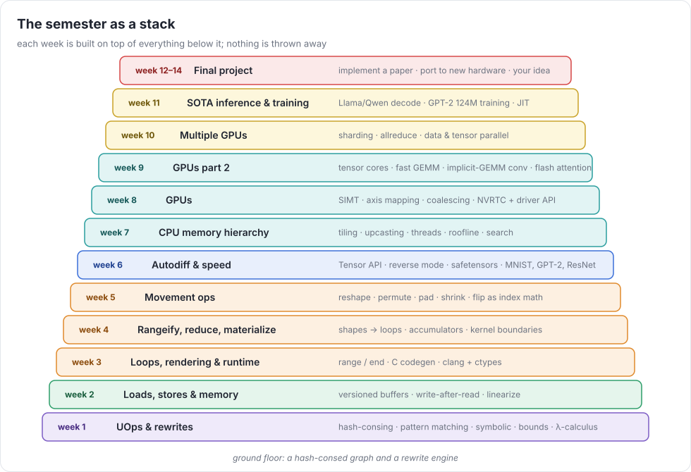
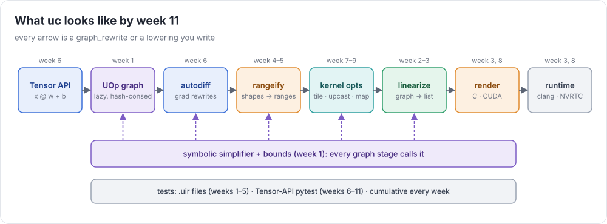

# Build an ML Compiler

A hands-on, one-semester course. You write **`uc`**, a machine-learning compiler, from scratch.
It starts with `add 2 3` and ends with training GPT-2 and serving a modern LLM on an H100.
Each week builds aggressively on the last. Keep your code simple: mistakes and unnecessary complexity compound.



## What you build



By the end of the course you should be able to:

1. Design an intermediate representation, and implement graph rewrites and symbolic simplification.
2. Generate and run correct C and GPU code from tensor programs.
3. Implement movement operations, reductions, kernel fusion, and automatic differentiation.
4. Optimize kernels for memory hierarchies, parallelism, and accelerator hardware.
5. Test and maintain a growing compiler codebase, and use it to train real models.

## Schedule

Self-paced. Each week: read 3 lectures, take the quiz, write your own tests, then write the compiler. Do the weeks in order.

| week | topic | example | lecture notes | quiz | assignment |
|---|---|---|---|---|---|
| 1 | **UOps & rewrites.** Hash-consed graphs, elementwise ops, λ-calculus, bounds | `%sum = add 2 3` | [notes](docs/week01/lecture.md) | [quiz](docs/week01/quiz.md) | [hw](docs/week01/assignment.md) |
| 2 | **Loads, stores & memory.** Buffers, versioned memory, ordering | `%b1 = store %b 2 7` | [notes](docs/week02/lecture.md) | [quiz](docs/week02/quiz.md) | [hw](docs/week02/assignment.md) |
| 3 | **Loops, rendering & runtime.** Ranges, C codegen, matmul and conv | `%i = range 10` | [notes](docs/week03/lecture.md) | [quiz](docs/week03/quiz.md) | [hw](docs/week03/assignment.md) |
| 4 | **Rangeify, reduce, materialization.** Shapes → loops, accumulators, kernels | `reduce %v op=add pop=1` | [notes](docs/week04/lecture.md) | [quiz](docs/week04/quiz.md) | [hw](docs/week04/assignment.md) |
| 5 | **Movement ops.** reshape, permute, pad, shrink, flip; rank > 1 | `permute %m [1 0]` | [notes](docs/week05/lecture.md) | [quiz](docs/week05/quiz.md) | [hw](docs/week05/assignment.md) |
| 6 | **Autodiff & speed.** Tensor API, reverse mode, safetensors, MNIST, GPT-2/ResNet inference | `loss.backward()` | [notes](docs/week06/lecture.md) | [quiz](docs/week06/quiz.md) | [hw](docs/week06/assignment.md) |
| 7 | **Memory hierarchies, kernels, threading.** Tiling, SIMD, threads, search | `UC_THREADS=8` | [notes](docs/week07/lecture.md) | [quiz](docs/week07/quiz.md) | [hw](docs/week07/assignment.md) |
| 8 | **GPUs.** SIMT, axis mapping, NVRTC + driver API, competitive CUDA | `device="CUDA"` | [notes](docs/week08/lecture.md) | [quiz](docs/week08/quiz.md) | [hw](docs/week08/assignment.md) |
| 9 | **GPUs part 2.** Tensor cores, fast GEMM, conv, flash attention | `bf16 @ bf16` | [notes](docs/week09/lecture.md) | [quiz](docs/week09/quiz.md) | [hw](docs/week09/assignment.md) |
| 10 | **Multiple GPUs & sharding.** Allreduce, data/tensor parallel | `x.shard(devs, 0)` | [notes](docs/week10/lecture.md) | [quiz](docs/week10/quiz.md) | [hw](docs/week10/assignment.md) |
| 11 | **SOTA inference & training.** Qwen/Llama decode, GPT-2 124M training, JIT | `@jit` | [notes](docs/week11/lecture.md) | [quiz](docs/week11/quiz.md) | [hw](docs/week11/assignment.md) |
| 12–14 | **Final project.** A paper, unusual hardware, or your own idea | | [guide](docs/week12/final-project.md) | | proposal → code + report |

**Start with [mapping.md](mapping.md):** what you write each week, where everything is, and how to work through it.
The ground rules and the reading list are in [SYLLABUS.md](SYLLABUS.md).

## Repository layout

```
compiler/uc/        YOUR compiler (starts as stubs with the required interfaces documented)
tests/weekNN/       the public tests: .uir files (weeks 1–5) and pytest files (weeks 6–11)
tests/weekNN/mine/  the tests YOU write each week ("tests due")
tests/ref/          PyTorch reference models (GPT-2, Llama/Qwen, ResNet-18) used by the tests
reference/oracle.py an executable spec of UIR: checks .uir tests without a compiler
reference/torch_shim/  the Tensor API on PyTorch: checks Python tests and your model code
docs/               lectures, quizzes, assignments, the UIR spec, the Tensor API, figures
benchmarks/         roofline, LLM decode speed, GPT-2 training (yours vs PyTorch)
tools/              download.py (data and weights)
```

There are no solutions in this repository: `compiler/uc/` is stubs, and you write the rest.

## Quick start

```bash
python -m venv .venv && source .venv/bin/activate
pip install numpy pytest hypothesis torch        # torch is a *reference* only; uc never imports it
pip install -e compiler

UC_ORACLE=1 pytest tests/week01      # the tests themselves are right (the oracle passes them)
pytest tests/week01                  # ...and your compiler doesn't yet. Start at docs/week01/lecture.md
pytest tests/week{01..03}            # later: always rerun every week so far (here, weeks 1-3)
```

The Python tests for weeks 1 and 6+ import `uc`, so they fail until you've written that week's code.

Requirements: Python ≥ 3.11, `clang` (week 3+; any clang-compatible driver on your `PATH` named `clang` works, including `zig cc`), an NVIDIA GPU with a CUDA driver (week 8+). The course
assumes one **H100**. Week 10 explains how to test multi-GPU code on it, and when to rent more GPUs.

## The two reference tools

You'll write tests every week before you write the compiler. Two tools let you check those tests
without a working compiler:

* **`reference/oracle.py`** runs `.uir` files. It's a slow, eager numpy interpreter of [the spec](docs/uir-spec.md).
  `UC_ORACLE=1 pytest tests/week03` or `python reference/oracle.py my_test.uir`.
* **`reference/torch_shim`** implements [the Tensor API](docs/tensor-api.md) with PyTorch.
  `UC_TORCH_SHIM=1 pytest tests/week06` checks the Python tests *and* your `uc/models/*.py` code.

If a test fails under these tools, the test is wrong. If it passes under them and fails on `uc`, your compiler is
wrong, with one exception: the oracle checks that a `prove` is *true* and that indices are *in bounds*, not that the
[required rules](docs/uir-spec.md#the-required-simplification-rules-for-prove) can derive it. Check that part of your own tests by hand.

## Extending `uc` after the course

Finish the weeks in order first: each one depends on the last. The [final project](docs/week12/final-project.md) is
the natural first extension, and its guide lists concrete ideas. Directions that go beyond it:

- **New backends:** Metal, ROCm/AMD, Vulkan, WebGPU, or emitting LLVM IR or MLIR instead of C source.
- **Better optimization:** search over schedules, cost models, equality saturation (egg is on the week-1 reading list).
- **Low precision:** fp8 training, int4 inference, sparsity.
- **A model front end:** import ONNX or PyTorch graphs, so `uc` runs models that weren't written against its Tensor API.
- **Serving:** KV-cache paging, continuous batching, speculative decoding.

Before you publish anything built on this:

- **License:** the repo has no LICENSE file. Find out what terms the course materials allow.
- **Split the repo:** only `compiler/uc/` and the tests are the compiler. Lectures and quizzes are course material.
- **Hardware:** weeks 8–11 are tuned for one H100. Other GPUs need a more general backend.

## Regenerating the figures

`python docs/figures/make_figures.py` rewrites every SVG under `docs/` from `docs/figures/figs_*.py`.
