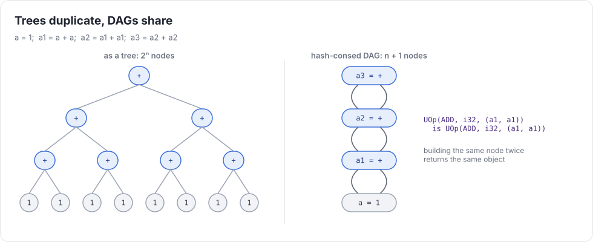
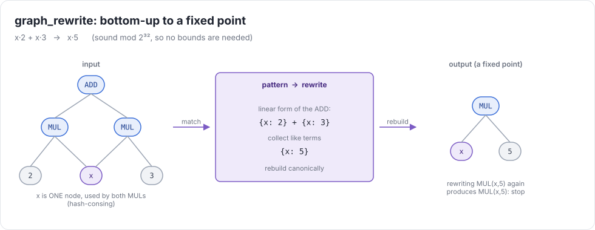
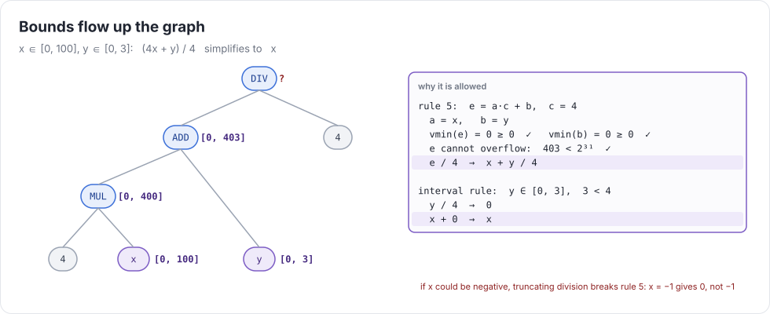
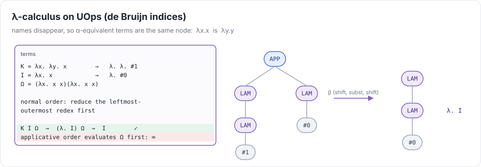

# Week 1 — UOps & rewrites

> **Goal of the week:** a hash-consed graph IR, a pattern-matching rewrite engine, and a symbolic simplifier
> with bounds. By Friday, `run_uir("%sum = add 2 3\n%test = assert %sum 5")` works, and so does
> `prove (cmpeq (div (add (mul %x 4) %y) 4) %x)`.

Everything later in the course is built from this week's three pieces: **UOp**, **PatternMatcher**, and
**graph_rewrite**. Rangeify, autodiff, kernel optimization, and GPU lowering are all graph rewrites.
Take the time to get these right. A sloppy hash-consing table or a non-terminating rule will cost you hours in week 5.

---

## Lecture 1.1 — An IR made of UOps

### Why a compiler at all?

An ML program is a dataflow graph of tensor operations: `relu(x @ W + b)`. Run eagerly, op by op, and each op
reads its inputs from memory and writes its output back. For `relu(x @ W + b)`, that means three round trips through DRAM,
when one fused kernel would do. A compiler sees the whole graph. It can **fuse** ops, **choose loop orders and tile sizes**
for the memory hierarchy, and **map** the work onto SIMD lanes, threads, warps, and tensor cores. It can do all of that
without the user changing a line of model code.

The hard part is not any single optimization. It's having **one representation** in which all of them are easy to
express and easy to check. That's this week.

### The UOp

A UOp ("micro-op") is an immutable node with four fields:

```python
UOp(op: Ops, dtype: DType, src: tuple[UOp, ...], arg: Any)
```

| field | example | meaning |
|---|---|---|
| `op` | `Ops.ADD` | what it does |
| `dtype` | `dtypes.i32` | the type of the value it produces |
| `src` | `(a, b)` | the operands. Nodes **point at their inputs**, so the graph is a DAG |
| `arg` | `3` for a `CONST`, `(0, 10, "x")` for a `VAR` | static data that isn't another UOp |

That's the whole IR. No basic blocks, no instruction list, no variables. A program is a DAG. Statements in
the text format are just names for nodes. This is a "sea of nodes" design (Click, 1995), the same family as tinygrad's UOps
or a JAX jaxpr flattened into a graph. Order exists only where data dependence creates it. Week 2 adds the edges that
memory needs, and week 3 shows how loops fit.

### Hash-consing

**Hash-consing** means that constructing a node with the same `(op, dtype, src, arg)` as an existing live node
returns *that node*:

```python
assert UOp(Ops.ADD, i32, (a, b)) is UOp(Ops.ADD, i32, (a, b))
```



Why it matters:

1. **Common-subexpression elimination for free.** Two identical computations are one node.
2. **Structural equality is pointer equality.** `x is y` is O(1). Every pattern match, every memo table,
   and every cache key (week 6's compile cache!) relies on this.
3. **Memory.** `tests/week01/cse_big_dag.uir` has 2³⁰ paths and 31 nodes.

Implementation sketch:

```python
class UOp:
  __slots__ = ("op", "dtype", "src", "arg", "__weakref__")
  _cache = weakref.WeakValueDictionary()
  def __new__(cls, op, dtype, src=(), arg=None):
    key = (op, dtype, tuple(id(s) for s in src), arg_key(arg))
    if (u := UOp._cache.get(key)) is not None: return u
    u = super().__new__(cls)
    ...set fields with object.__setattr__ ...
    UOp._cache[key] = u
    return u
  def __setattr__(self, k, v): raise AttributeError("UOps are immutable")
```

Three details that bite:

* **Weak values.** A normal dict keeps every UOp you ever built alive. A `WeakValueDictionary` drops entries when
  nothing else refers to them. Keying on `id(s)` is safe only because a live entry keeps its sources alive (through `u.src`),
  so their ids can't be reused while the entry exists.
* **Float keys.** In Python, `0.0 == -0.0` and `hash(0.0) == hash(-0.0)`, but `1/0.0 = +inf` and `1/-0.0 = -inf`.
  And `nan != nan`, so a nan constant would never be found again. Key floats by their **bits**:
  `struct.pack("<d", x)`. The tests `float_negzero.uir` and `test_float_keys` check exactly this.
* **Immutability.** Two users share every node. If one mutates it, the other's program silently changes.

### Toposort without recursion

You'll walk graphs constantly. Use an explicit stack: week 6's autodiff graphs and week 11's unrolled models are
far deeper than Python's recursion limit of 1000.

```python
def toposort(self):
  seen, out, stack = set(), [], [(self, False)]
  while stack:
    u, expanded = stack.pop()
    if expanded: out.append(u); continue
    if u in seen: continue
    seen.add(u); stack.append((u, True))
    stack.extend((s, False) for s in reversed(u.src) if s not in seen)
  return out
```

### The UIR text format

Tests are written in UIR ([spec](../uir-spec.md)). One statement per line, SSA names, nested expressions in parens:

```
%x = 7
%y = mul %x (add %x 1)
%t = assert %y 56
```

Your parser builds UOps **and type-checks as it builds**. Every statement must be well-typed, even dead code
(`dtype_mismatch_dead.uir`). Keep the parser boring. A tokenizer regex plus a recursive-descent `expr()` is about 80 lines.

Typing rules this week: `i32`, `f32`, `bool`, **no implicit promotion** (`add 1 2.0` is an error), comparisons return
`bool`, and `where` needs a `bool` condition. Model `sub a b` as `add a (neg b)` and you'll have one less op to simplify.

### Running a week-1 program

There is no runtime yet. Every program is closed (constants only), so **running it means simplifying it**: rewrite
each `assert` to a constant and check that it's `true`. Week 2 adds an interpreter, week 3 a C backend.

---

## Lecture 1.2 — Term rewriting

### Patterns

A rewrite rule is a pair *(pattern, function)*. A pattern describes a set of UOps:

```python
UPat(Ops.ADD, src=(UPat.var("x"), UPat(Ops.CONST, arg=0)))     # x + 0
```

Matching produces **bindings** (`{"x": <UOp>}`) that are passed to the function, which returns a replacement UOp or
`None` (no change). A name used twice must bind the **same node**: `ADD(x, x)` matches `a + a` but not `a + b`.
Because of hash-consing, that check is `is`.

Commutative ops (`ADD`, `MUL`, `MAX`, `CMPEQ`, …) should match in either source order. Otherwise you need two copies of
every rule.

```python
pm = PatternMatcher([
  (UPat(Ops.ADD, src=(UPat.var("x"), UPat.cvar("c", arg=0))), lambda x, c: x),
  (UPat(Ops.MUL, src=(UPat.var("x"), UPat.cvar("c", arg=1))), lambda x, c: x),
  ...
])
```

### graph_rewrite

```python
def graph_rewrite(sink, pm):
  memo = {}
  def rw(u):
    if u in memo: return memo[u]
    src = tuple(rw(s) for s in u.src)                    # 1. sources first (bottom-up)
    y = UOp(u.op, u.dtype, src, u.arg) if src != u.src else u
    z = pm.rewrite(y)                                     # 2. then this node
    memo[u] = out = y if z is None else rw(z)             # 3. until nothing applies
    return out
  return rw(sink)
```

Three properties to keep in mind:

* **Bottom-up.** When a rule fires on a node, its sources are already in normal form. Rules can assume that.
* **Memoized.** A DAG with shared nodes is visited once per node, not once per path (`test_rewrite_is_bottom_up_and_memoized`).
* **Fixed point.** The result of a rewrite gets rewritten again. That's what makes `((x+0)+0)+0 → x` work.



### Termination and confluence

A rewrite system is a set of rules applied until none matches. Two questions decide whether it's any good:

* **Termination:** does it always stop? `x + y → y + x` alone loops forever. Fix it by **orienting** rules toward a
  canonical form: "constants on the right", "operands sorted by a fixed key". A rule must make the term *smaller* in
  some well-founded order.
* **Confluence:** does the order of rule application matter? If two rules overlap (a *critical pair*) and lead to different
  normal forms, `prove` succeeds or fails depending on traversal order. Canonical forms are the practical fix:
  when every rule pushes toward one normal form, overlaps rejoin.

You won't prove these properties formally. But every time you add a rule, ask: *does this make the term smaller in some order,
and does it agree with my other rules?*

> **Aside: equality saturation.** egg (Willsey et al.) stores *all* equivalent forms in an e-graph instead of choosing
> one, so rule order stops mattering. It's powerful, and too heavy for this course. Our rewrites are destructive and
> greedy, and that's why they need canonical forms.

### Constant folding with target semantics

Folding `ADD(CONST 2, CONST 3)` is easy. Folding it **correctly** is not:

| trap | Python says | the target says |
|---|---|---|
| `2147483647 + 1` | `2147483648` | `-2147483648` (i32 wraps) |
| `-7 / 2` (int) | `-4` (`//` floors) | `-3` (C truncates) |
| `-7 % 2` | `1` | `-1` |
| `16777216.0 + 1.0` (f32) | `16777217.0` (f64) | `16777216.0` |
| `0.1 + 0.2 == 0.3` (f32) | `False` (f64) | `True` |

Write **one function** that implements the ALU semantics exactly: `exec_alu(op, dtype, *values)`.
Constant folding, the week-2 interpreter, and your tests all call it. Three copies of "what does i32 division do"
*will* disagree eventually, and the bug will show up three weeks later in an unrelated test.

### Soundness

A rule is **sound** if it preserves meaning *for every possible value* of its variables. Some unsound rules look
perfectly innocent:

| rule | why it's wrong |
|---|---|
| `cmpeq x x → true` | `x` may be nan (f32). `nan_hashcons_trap.uir` |
| `x * 0 → 0` | wrong for f32 inf and nan |
| `x + 0.0 → x` | wrong for `x = -0.0`: `-0.0 + 0.0 = +0.0` |
| `(a + b) + c → a + (b + c)` | wrong for f32 (rounding). Fine for i32 (mod 2³²) |
| `x < x + 1 → true` | wrong for i32 `x = 2147483647`. `prove_overflow_unsound.uir` |
| `(x * c) / c → x` | wrong when `x * c` overflows. `prove_div_overflow.uir` |

The rule of thumb: **integer ring identities are free; anything involving order, division, or floats needs a proof
obligation**, usually discharged with bounds (next lecture).

---

## Lecture 1.3 — Symbolic simplification, bounds, and the λ-calculus

### A canonical form for integer arithmetic

Sums of products of i32 terms are the bread and butter of index math. In week 5 every load index is one of these.
Represent a sum as a **linear form**, a map `term → coefficient` plus a constant:

```
x*2 + (y + x*3) + 4  →  {x: 5, y: 1} + 4
```

and rebuild it in a fixed order (sort terms by a stable key: creation order of the hash-consed node works).
Because i32 arithmetic is a ring mod 2³², collecting like terms and folding constants is **always sound**, with no
bounds needed. With a canonical form, `prove (cmpeq (add (mul %x 2) (mul %x 3)) (mul %x 5))` is just
"both sides rewrite to the same node, and `cmpeq(a, a) → true` for ints."

### Interval analysis

Give every i32 node an interval `[vmin, vmax]`:

| op | bounds |
|---|---|
| `CONST c` | `[c, c]` |
| `VAR lo hi`, `RANGE n` (week 3) | `[lo, hi]`, `[0, n-1]` |
| `a + b` | `[amin + bmin, amax + bmax]` |
| `a * b` | min/max of the four corner products |
| `a / c` (c > 0) | `[amin / c, amax / c]` (truncating, monotone) |
| `a % c` (c > 0, amin ≥ 0) | `[0, min(amax, c-1)]` |
| `max`, `min`, `where` | the obvious combinations |
| anything else | the full i32 range |

**Compute exactly, then widen.** Use Python ints, and if the exact interval leaves `[-2³¹, 2³¹-1]`, replace it with
the full range. That single line is what makes every bounds-based rule sound under wraparound.



Rules that use bounds:

* `cmplt a b → true` if `vmax(a) < vmin(b)`, and `→ false` if `vmin(a) ≥ vmax(b)`
* `max a b → a` if `vmin(a) ≥ vmax(b)`
* a node whose interval is a single point becomes that constant
* **the division rule:** `(a·c + b) / c → a + b / c` when the whole sum is non-negative and can't overflow and `b ≥ 0`.
  With `0 ≤ b < c`, the leftover `b / c` folds to 0.

That last rule is **week 5's reshape**: flattening `(i, j)` to `i*W + j` and splitting it back with `/ W` and `% W` is
the identity. Your simplifier should *prove* that, not just hope.

### `prove`

`prove c` asks the compiler to show, at compile time, that `c` is true for every value of its variables.
Your implementation: simplify `c`, then succeed only if the result is the constant `true`. Anything else is a
`CompileError`. A sound but weak simplifier fails to prove some true facts, which is acceptable. An unsound one
"proves" false ones, which is not. Every `prove` test uses only the [required rules](../uir-spec.md#the-required-simplification-rules-for-prove).

### The λ-calculus as a rewrite system

The λ-calculus is the smallest interesting term-rewriting system: three constructors (variable, abstraction,
application) and one rule (β). Building it on your UOps is a stress test for your engine, and it teaches three ideas
you'll meet again.



1. **Representation decides equality.** With named variables, `λx.x` and `λy.y` are different trees. With
   **de Bruijn indices** (a variable is "how many λs up is my binder"), they're the same UOp. Choosing the
   representation so that "means the same thing" becomes "is the same node" is the whole game in compiler IRs.
   You'll do it again in week 3, when two textually identical `range 10`s must *not* be the same node.
2. **Substitution is a graph rewrite.** β-reduction substitutes an argument for a variable, with index shifting to avoid
   capture. Inlining, autodiff's chain rule, and specialization all have this shape.
3. **Strategy matters.** `(λx.λy.x) I Ω` has a normal form under **normal order** (reduce the leftmost-outermost redex
   first), but loops forever under applicative order, which evaluates `Ω` first. By the Church–Rosser theorem, if a normal form
   exists it's unique, but *finding* it depends on the strategy. Your symbolic rewriter has the same issue on a smaller
   scale. Give your rewriter a step limit and raise `NonTerminating` past it.

```python
def shift(t, d, cutoff=0): ...      # add d to every free index ≥ cutoff
def subst(t, j, s): ...             # replace index j by s (shifting s under binders)
def beta(lam_body, arg): return shift(subst(lam_body, 0, shift(arg, 1)), -1)
```

Church numerals make good tests: `PLUS 2 3` must normalize to *the same node* as `church(5)`.

### Common mistakes that compound

* A strong-reference cache. Memory grows without bound by week 6.
* Recursive toposort or recursive rewrite *without* raising the recursion limit. It crashes in week 6.
* Folding in Python floats. Wrong answers in week 4's reductions.
* An unsound "helpful" rule. Silent wrong answers in week 5, when index math gets complicated.
* Patterns that check `==` instead of `is` on bound names. Slow, and wrong for nan.

### Further reading

* Baader & Nipkow, *Term Rewriting and All That*, ch. 1–2 (termination, confluence, critical pairs)
* Filliâtre & Conchon, *Type-Safe Modular Hash-Consing* (2006)
* Pierce, *Types and Programming Languages*, ch. 5–6 (λ-calculus, de Bruijn indices)
* Willsey et al., *egg: Fast and Extensible Equality Saturation* (POPL 2021)
* tinygrad's `uop/ops.py` and `uop/symbolic.py`: a production version of this week, worth skimming *after* you've written yours
