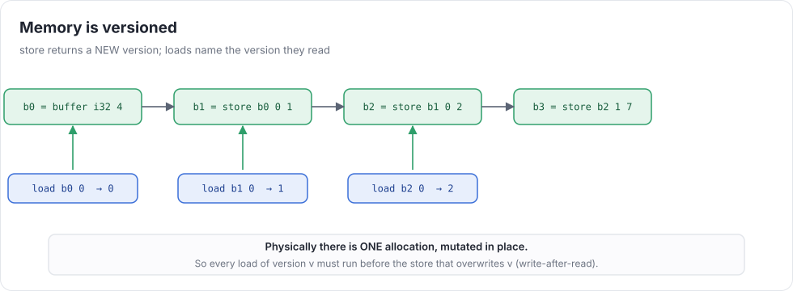
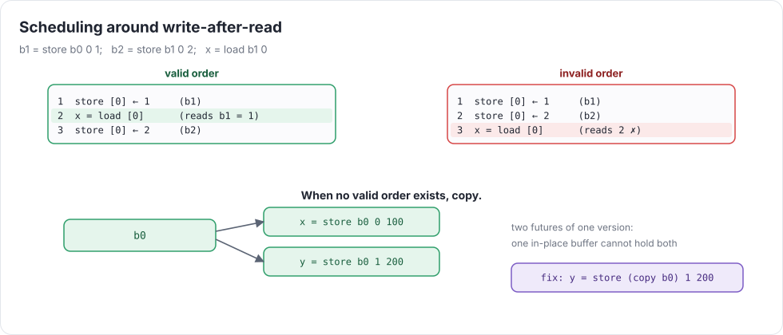
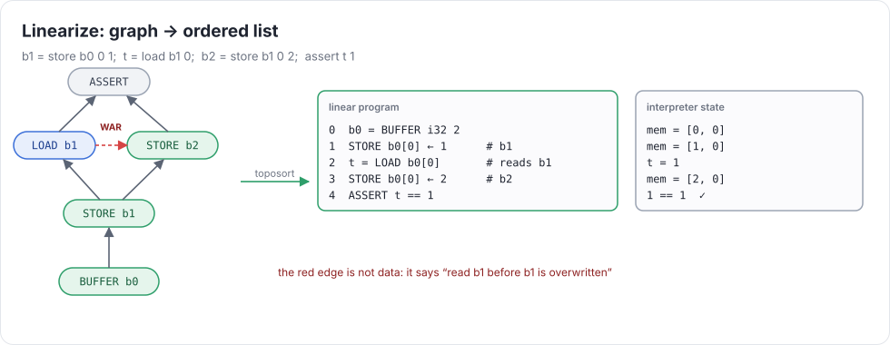

# Week 2 — Loads, stores & memory

> **Goal of the week:** buffers you can load from and store to, bounds you *prove* at compile time, a schedule
> that respects memory order, and an interpreter that runs it.

Week 1 programs were pure: every node was a value, and the order of evaluation didn't matter. Memory breaks
that. A load depends on *which* store happened before it, and a graph has no "before". This week we put memory
into the graph without giving up what made week 1 work: hash-consing, rewriting, and order only where data demands it.

---

## Lecture 2.1 — Memory as values

### Buffers and versions

```
%b0 = buffer i32 4          # a fresh, zero-initialized buffer: version 0
%b1 = store %b0 2 7         # NOT a mutation: a new version, equal to b0 except b1[2] = 7
%x  = load %b1 2            # reads version b1  →  7
%y  = load %b0 2            # reads version b0  →  0
```

`store` returns a **new version** of the buffer, and `load` names the version it reads. This is *functional memory*.
It's the same idea as Memory SSA in GCC/LLVM, and as the `AFTER` edges in tinygrad's UOps.



What this buys us:

* **Memory order is data dependence.** `load %b1` depends on `store … → %b1` through an ordinary `src` edge.
  Toposort, rewriting, and hash-consing work unchanged.
* **Rewrites stay local and checkable.** Store-to-load forwarding is a pattern:
  `load (store B i v) i → v`, and `load (store B i v) j → load B j` when `i ≠ j` is *provable*.
  (Using the week-1 simplifier: `cmpne i j` must fold to `true`.)
* **Identical loads share.** Two `load %b1 2` are one node: CSE for free, and sound, because they read the same version.

What it costs: the hardware has **one** allocation that gets mutated in place. Section 2.2 is about closing that gap.

### UOps for memory

A minimal set: `BUFFER` (arg: a unique id, size, initial data), `STORE` (src: buffer-version, index, value;
dtype: the buffer), and `LOAD` (src: buffer-version, index). Give every `BUFFER` a **unique id** in its `arg`.
Two `buffer i32 4` statements are different buffers even though they look identical. (λ-calculus gave you the
opposite lesson: there, identical structure *should* mean identical node. Here it must not.)

### Bounds are proof obligations

Every `load` and `store` index must be proven in `[0, N)` **at compile time**, with your week-1 intervals:

```python
def check_bounds(idx, n):
  lo, hi = bounds(simplify(idx))
  if not (0 <= lo and hi < n): raise CompileError(f"index in [{lo}, {hi}] may be out of [0, {n})")
```

No runtime checks are allowed. That decision has consequences:

* A loaded value has no useful bounds (it could be anything), so `load %b (load %idx 0)` is rejected.
  Clamp it, `max 0 (min (load …) 3)`, and the bounds become `[0, 3]`. (See `old_version_depends_on_new.uir`.)
* The quality of your simplifier now decides which programs compile. In week 3, `load %b (div (add (mul %i 4) %j) 4)`
  is in bounds only if rule 5 fires (`bounds_need_simplifier.uir`).

This is the payoff from week 1. Later, GPU kernels index with exactly this kind of expression, and an out-of-bounds
access on a GPU isn't an exception. It's silent corruption or a hang.

---

## Lecture 2.2 — Ordering: from versions to one mutable buffer

### Dependences

Classic dependence analysis has three kinds of edges between memory operations on the same location:

| kind | meaning | in our IR |
|---|---|---|
| **RAW** (true) | read after write | a `src` edge: `load b1` uses `b1 = store …` |
| **WAW** (output) | write after write | a `src` edge: `b2 = store b1 …` uses `b1` |
| **WAR** (anti) | write after read | **missing**: the store that overwrites `b1` doesn't know who reads `b1` |

WAR edges are the ones the graph doesn't contain. Here's the rule:

> If version `v` is overwritten in place by `store v …`, then **every load of `v` must run before that store**.



### Building the schedule

1. Find each buffer's **version chain**: `b0 → b1 → b2 → …`, linked by `store`s.
2. For each version `v` with a successor store `s = store v …`, add an ordering edge `load(v) → s` for every load of `v`.
3. Toposort with these extra edges.

If the extra edges make a **cycle**, there is no valid in-place order. Two shapes cause it:

* **Forks:** `x = store b0 …` and `y = store b0 …`. Two futures of one version can't share one allocation.
* **Old reads that depend on new versions:** `load b0 (load b1 0)` must run before `b1`'s store, and also after it.

The fix is the one every compiler uses: **copy**. Materialize `b0` into a fresh buffer for one of the branches and
rewrite its users to point at the copy. Detect the cycle, pick the cheaper side, insert `COPY`. In practice forks
are rare (week 6's `assign` is the main source), so simple and correct beats clever.

### Rewrites on memory

Two classic optimizations, both as patterns:

* **Store-to-load forwarding:** `load (store B i v) i → v`
* **Dead store elimination:** a `store` whose version is never read and is not a program output can be deleted.
  (Watch out: in week 3 the "output" of a loop is the `end`, and in week 6 it's a tensor the user still holds.)

Neither is required this week. But writing forwarding is a good test of whether your bounds and `cmpne` rules can
*prove* `i ≠ j`. If it can't, the rule must not fire.

---

## Lecture 2.3 — Linearize and interpret

### Linearization

The backend wants a list of instructions, not a graph. **Linearize** = toposort the sink (with the memory-order edges)
into a list where every UOp appears after its sources and memory order holds:



Then a tiny interpreter runs it:

```python
def interpret(program):
  vals, mem = {}, {}
  for u in program:
    if u.op is Ops.BUFFER: mem[u.arg.id] = list(u.arg.init); vals[u] = u.arg.id
    elif u.op is Ops.STORE: buf = vals[u.src[0]]; mem[buf][vals[u.src[1]]] = vals[u.src[2]]; vals[u] = buf
    elif u.op is Ops.LOAD: vals[u] = mem[vals[u.src[0]]][vals[u.src[1]]]
    elif u.op is Ops.ASSERT: ...
    else: vals[u] = exec_alu(u.op, u.dtype, *[vals[s] for s in u.src])   # week 1's single source of truth
  return vals
```

Notice that a `STORE`'s "value" is just the buffer id. All versions of a buffer alias one list. That's exactly the
in-place reality that the WAR edges protect.

### Debugging tools you should build now

* `print_program(list)`: one line per UOp with an index, op, dtype, and source indices. You'll read thousands of these.
* `UOp.render()` from week 1's stretch: any graph as UIR.
* A `DEBUG` environment variable that prints the linearized program before running it.

### Testing a compiler

This week you write your tests *before* the implementation. Some practices that pay off for the rest of the course:

* **Test the spec, not your implementation.** Each test should be a fact about UIR semantics. Check it with the oracle.
* **Cover the edges**: zero-sized things (none are legal: check the error), the first and last index, negative
  values, aliasing (two versions of one buffer), and the cases where an optimization *must not* fire.
* **Differential testing.** From week 3 on, run every program with `UC_BACKEND=interp` and `UC_BACKEND=c` and compare.
  The interpreter is your second oracle.
* **Random program generation.** Generate small random programs (a few buffers, a few stores and loads with constant
  indices), run them on the oracle and on your compiler, and compare. Twenty lines of generator finds bugs that
  fifty hand-written tests miss.

### Common mistakes that compound

* Deduplicating buffers by structure, so two `buffer i32 4` become one.
* Running bounds checks before simplification (rejects valid programs) or skipping them for "obviously fine"
  constant indices (still needs the check: `oob_computed.uir`).
* A linearizer that is correct only for the order you happened to write the statements in. Shuffle the statement
  order in your tests: the graph is the same, so the answer must be too.

### Further reading

* Click & Paleczny, *A Simple Graph-Based Intermediate Representation* (1995)
* Novillo, *Memory SSA: A Unified Approach for Sparsely Representing Memory Operations* (GCC Summit 2007)
* Any compilers text on dependence analysis (e.g. Allen & Kennedy, *Optimizing Compilers for Modern Architectures*, ch. 2)
