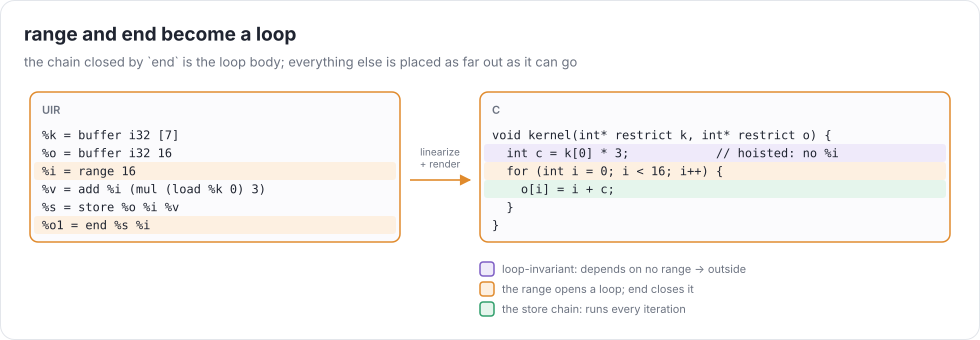
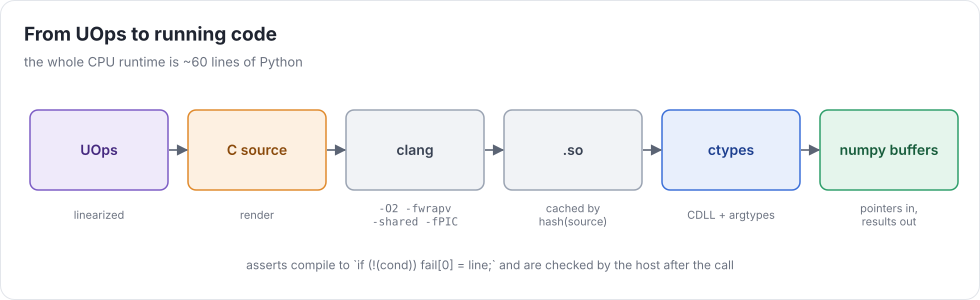
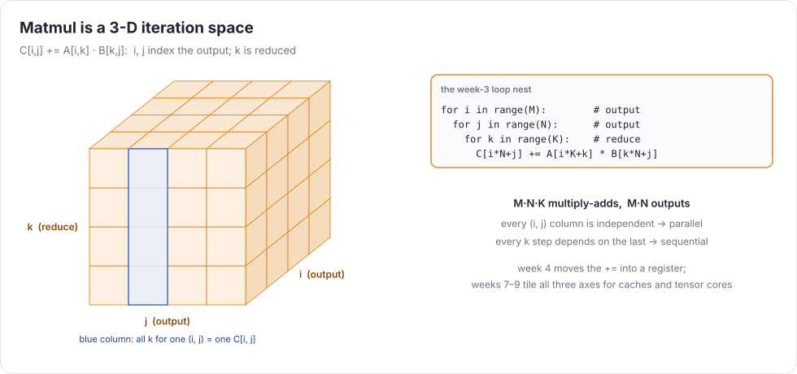

# Week 3 — Loops, rendering & runtime

> **Goal of the week:** `range` and `end` in the IR, a linearizer that builds loop nests, a C renderer, and a
> runtime that compiles with clang and calls the result through `ctypes`. Matmul and convolution run as real
> machine code.

---

## Lecture 3.1 — Loops in a graph

### range and end

```
%b  = buffer i32 10
%i  = range 10                  # a loop index: values 0..9, bounds [0, 9]
%s  = store %b %i (mul %i %i)   # depends on %i: "inside" the loop
%b1 = end %s %i                 # run the chain for every %i; the result is the final version
```

A `RANGE` is a value like any other. Its bounds are `[0, N-1]`, which is what lets week-2 bounds checking accept
`store %b %i …`. Like buffers, ranges have **identity**: two `range 10` statements are two different loops
(`ranges_are_distinct.uir`). Give each `RANGE` a unique id in its `arg`.

`END(chain, ranges…)` closes the loops. Its semantics ([spec §5](../uir-spec.md#5-week-3--loops-rendering-runtime)):

* The **body** is found *structurally*: unwrap directly nested `end`s, then walk down the chain of `store`s to the first
  non-store, the **root** (a `buffer` or an earlier `end`).
* Every store on the chain runs **once per iteration**, even if it doesn't mention the loop variable
  (`no_hoist_after_simplify.uir`).
* Inside the loop, the root means *the buffer's current contents*: state carries across iterations.
  That's what makes `store C i (add (load C i) x)` accumulate.

Why structural? The alternative, "a store is in the loop if it depends on `%i`", lets the simplifier change
program meaning. After `mul %i 0 → 0`, a store that ran 5 times would run once. **Value rewrites must never change
memory semantics.** Keep that principle in mind for the rest of the course.

### Placing every node

Everything that isn't on a store chain is placed by **dependence**:

> A node belongs in the innermost loop among the ranges it (transitively) depends on, and no deeper.

```python
def ranges_of(u):        # memoized
  if u.op is Ops.RANGE: return {u}
  if u.op is Ops.END: return ranges_of(u.src[0]) - set(u.src[1:])
  if u.op is Ops.LOAD and is_loop_carried(u.src[0]): return ranges_of(u.src[1]) | loop_ranges(u.src[0])
  return set().union(*(ranges_of(s) for s in u.src))
```

Note the `LOAD` case: a load of the loop-carried root depends on the loop **even if its index doesn't**, because its
value changes every iteration. Forgetting this hoists `load C[0]` out of the accumulation loop and gives you the wrong sum.

**Loop-invariant code motion falls out for free.** `(load %k 0) * 3` depends on no range, so it's placed before the
loop (`loop_invariant.uir`).



### Asserts in loops

An `assert` that depends on open ranges is checked for every value (`assert_in_loop.uir`). The linearizer wraps it in
loops over its free ranges. An assert that reads an *unclosed* store is a compile error (`unclosed_range.uir`).

---

## Lecture 3.2 — Rendering C

### From the linear program to C

Linearize into a flat list with explicit loop markers, then print one line per UOp:

| UOp | C |
|---|---|
| `RANGE` (opening) | `for (int r3 = 0; r3 < 16; r3++) {` |
| `END` | `}` (one per closed range) |
| `CONST` | inline the literal (`1.5f`, `-7`, `1`), or `INFINITY` / `NAN` from `<math.h>` |
| ALU | `int v7 = v3 + v5;` with C operators. `max` → `(a > b ? a : b)` for ints, `fmaxf` for floats |
| `LOAD` | `float v9 = buf2[v8];` |
| `STORE` | `buf2[v8] = v9;` |
| `CAST` | `(float)v3`, `(int)v4` (C truncates toward zero, like UIR), `(v5 != 0)` for bool |
| `ASSERT` | `if (!(cond)) { fail[0] = LINE; }` |

The details that matter:

* **Signed overflow is undefined behavior in C.** Clang assumes it never happens, and it *will* optimize your
  wraparound tests into nonsense. Compile with `-fwrapv`, or do i32 arithmetic in `unsigned` and cast back (`wrap_in_c.uir`).
* **Float→int casts outside the int range are UB.** UIR leaves them undefined too, so tests avoid them.
* **`restrict`** on buffer pointers tells clang the buffers don't alias. Our IR guarantees that (distinct `BUFFER`s are distinct
  allocations; copies are explicit), so say it: it unlocks vectorization.
* **Exactness.** Use `fmaxf`/`fminf` carefully: they *ignore* nan, while UIR's `max` propagates it. Render
  `(a != a || b != b) ? NAN : fmaxf(a, b)`, or `a > b ? a : b` plus a nan check.
* **`-ffp-contract=off`**: otherwise clang may fuse `a*b + c` into an FMA. That's more precise, but it gives different
  bits from the interpreter. Differential testing needs identical bits.

### The runtime



```python
def compile_c(src: str) -> ctypes.CDLL:
  key = hashlib.sha256(src.encode()).hexdigest()[:16]
  so = CACHE_DIR / f"{key}.so"
  if not so.exists():
    with tempfile.NamedTemporaryFile("w", suffix=".c") as f:
      f.write(src); f.flush()
      subprocess.check_call(["clang", "-O2", "-fwrapv", "-ffp-contract=off", "-shared", "-fPIC",
                             "-march=native", f.name, "-o", str(so), "-lm"])
  return ctypes.CDLL(str(so))

lib = compile_c(src)
args = [np.ascontiguousarray(b) for b in buffers]
lib.kernel(*[a.ctypes.data_as(ctypes.c_void_p) for a in args])
```

That's about the whole CPU runtime. Buffers are numpy arrays (numpy is a convenient allocator, nothing more),
the kernel gets raw pointers, and the host reads the `fail` buffer afterwards to raise `AssertFailure`.

Cache compiled code by a hash of the source. Every test run would otherwise pay clang's ~50 ms per program.

---

## Lecture 3.3 — Real programs: matmul and convolution



Written with week-3 primitives, a matmul is three ranges and one accumulating store (`matmul_2x2.uir`). Two
things to notice:

1. The `k` loop carries a dependence through `C[i*N+j]`. The `i` and `j` loops don't. That's the parallelism we'll
   exploit in weeks 7–8.
2. The accumulator lives **in memory**: every iteration loads and stores `C[i,j]`. Clang may or may not keep it in a
   register. Week 4 makes it explicit, with a `REDUCE` that lives in a register by construction.

A convolution is the same pattern with more ranges and an index expression `(oy+ky)*W + (ox+kx)`
(`conv2d.uir`). Its bounds proof needs interval arithmetic on a sum of ranges: `[0, 1] + [0, 2] = [0, 3] < 4`. ✓

### Measuring

Time the interpreter and the C backend on `big_loop.uir`. The interpreter manages a few million UOps per second.
C at `-O2` runs a few billion simple operations per second. **Three orders of magnitude, before any optimization.**
Keep the interpreter anyway: it's your oracle for differential testing.

```bash
UC_BACKEND=interp pytest tests/week03 -q --durations=5
UC_BACKEND=c      pytest tests/week03 -q --durations=5
```

### Common mistakes that compound

* Defining loop membership by dependence instead of structure (wrong answers after simplification).
* Hoisting loads of loop-carried state.
* Forgetting `-fwrapv`. The tests pass at `-O0` and fail at `-O2`.
* Generating a C variable name per *statement* instead of per *UOp*. Hash-consed duplicates are one UOp and should be one variable.
* No compile cache. Test time climbs every week.

### Further reading

* Clang docs: `-fwrapv`, `-ffp-contract`, `restrict`
* Python `ctypes` documentation (CDLL, argtypes, `c_void_p`)
* Allen & Kennedy, ch. 2–3 (dependence, loop-invariant code motion)
