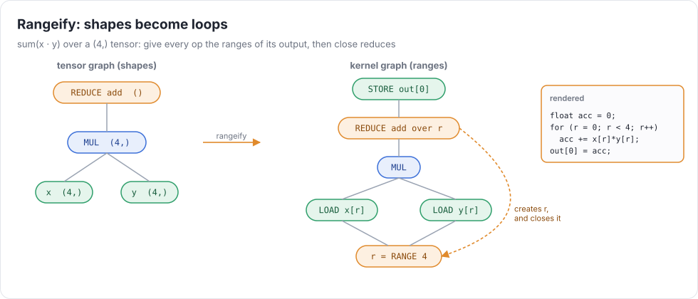
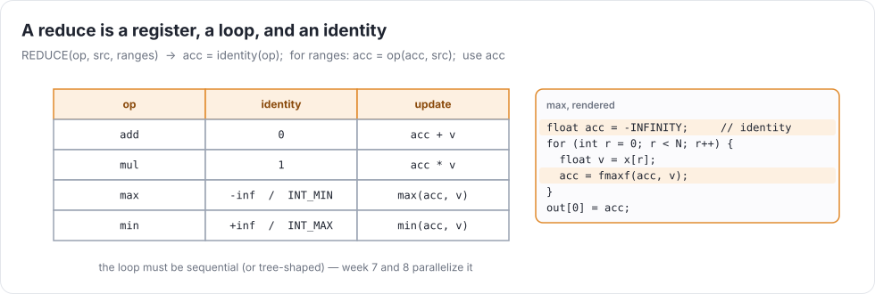
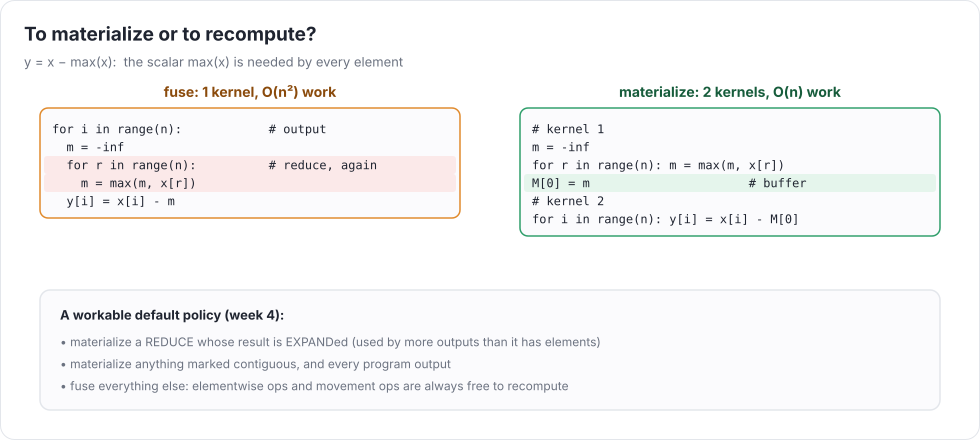

# Week 4 — Rangeify, reduce, and materialization

> **Goal of the week:** tensors. ALU ops on rank-1 values, `expand` and `reduce`, and the lowering that turns
> shapes into loops (**rangeify**). You also decide which intermediate tensors get written to memory (**materialization**),
> and those decisions define your **kernels**.

Until now the programmer wrote the loops. From this week, they write `reduce (mul %a %b) op=add pop=1`, and the
compiler writes the loops. This is the first time uc generates structure the user didn't spell out, and the first time
it makes a *performance decision* that tests check (`# max-kernels`).

---

## Lecture 4.1 — Tensors in the IR

A tensor-level UOp carries a **shape**: `[1 2 3]` has shape `(3,)`, a scalar has `()`. Shapes are static this
semester, so put them in the UOp (in `arg`, or as part of a richer dtype). They must take part in hash-consing.

The rules (spec §6):

* ALU ops are **elementwise** and need **identical** shapes. There's no implicit broadcasting. The front end
  (week 6) will insert explicit `expand`s, so the IR stays small and every broadcast is visible to the compiler.
* `expand x n` broadcasts a scalar to `(n,)`. In week 5 it generalizes to "grow size-1 axes".
* `reduce x op=OP pop=K` reduces the **last K axes**. One reduce form plus week 5's `permute` covers every axis choice.
* `index x i` extracts a scalar at static indices. `contiguous x` forces materialization.

Type-check shapes at parse time, just as you did dtypes. A shape mismatch is a compile error even in dead code.

---

## Lecture 4.2 — Rangeify

**Rangeify** turns a tensor graph into loops over scalars. The idea fits in one sentence:

> Give every tensor op the ranges of its **output**. Each source is then indexed with whatever ranges its
> own shape needs, and a reduce **creates** new ranges for the axes it removes and **closes** them.

Walk the graph top-down from each materialized output, carrying "the index expression for each axis of this tensor":

| tensor op | given output indices `idx` | its sources are indexed with |
|---|---|---|
| elementwise `f(a, b)` | `idx` | `a[idx]`, `b[idx]` |
| `expand` of a scalar | `idx` | `a[()]` (the index is ignored) |
| `reduce x pop=K` | `idx` (rank − K) | `x[idx + (r1…rK)]` with **new** ranges `r1…rK` |
| literal `[1 2 3]` / a buffer | `idx` | `LOAD(buf, flatten(idx))` |
| `index x 2` | `()` | `x[(2,)]` |

The output is a kernel: a `STORE` of the computed scalar into the output buffer at `flatten(idx)`, ended over the
output ranges. Week 5 adds movement ops to the table. Each one is just a different "sources are indexed with" column.

### The REDUCE UOp

A reduce lowers to a **register accumulator**, not a memory one like week 3's matmul:

Represent it as one UOp, `REDUCE(src, *ranges, arg=op)`, whose value is the reduction of `src` over `ranges`.
The linearizer renders it as `acc = identity; for (...) acc = op(acc, src); ` and places the uses of `acc` after the
loop. Keep it a single UOp until rendering. Rewrites like "reduce of a constant", "split a reduce" (week 7), and
"tensor-core reduce" (week 9) want to see the whole reduction as one node.

Identities: `add → 0`, `mul → 1`, `max → -inf` / `INT_MIN`, `min → +inf` / `INT_MAX`. i32 sums wrap
(`wrap_reduce.uir`).

---

## Lecture 4.3 — Materialization: what becomes a kernel?

A **kernel** is one function launch whose iteration space is one loop nest: outer *output* loops (iterations independent)
and inner *reduce* loops. That's the shape a GPU wants (week 8): one thread per output element, each doing its own reductions.

Rangeify can fuse *anything* into one kernel by recomputing. The question is when it should:

Consider `y = x - expand(max(x))`. Fused, every output element recomputes the whole max: O(n²). Materialized,
kernel 1 computes `m` into a 1-element buffer and kernel 2 reads it: O(n), with one extra launch and one tiny buffer.

A workable default policy:

1. **Materialize** every program output and everything marked `contiguous`.
2. **Materialize** a `reduce` whose result feeds an `expand`, i.e. a value used by more output elements than it has elements.
3. **Fuse** everything else. Elementwise and (week 5) movement ops are always cheap to recompute.

Then **schedule**: each materialized UOp becomes a kernel that loads its inputs from earlier kernels' buffers. Toposort the kernels.
Count launches in `Result.kernels`: tests assert upper bounds (`# max-kernels: 1` for an elementwise chain, ≤ 3 for softmax).

### Sharing

`%sq = mul %x %x` used by two outputs (`shared_subexpr.uir`): compute it twice inside fused kernels, or materialize it
once and load it twice. For elementwise ops recomputation is nearly always cheaper. Memory bandwidth is the scarce
resource (week 7's roofline makes this precise).

### Common mistakes that compound

* Rangeify that walks the *tree* instead of the DAG, so a shared subexpression is rangeified once per path. Memoize per (UOp, index tuple).
* A reduce rendered as week 3's load/store accumulation. It works, but it's slow, and it hides the reduction from later rewrites.
* Kernels with two sequential top-level loops. That's fine in C, but it isn't a kernel by our definition and won't map to a GPU.
* Not running the week-1 simplifier on the generated index expressions. It works now, but you'll pay for it in week 5.

### Further reading

* Ragan-Kelley et al., *Halide* (PLDI 2013): separating the algorithm from the schedule
* Chen et al., *TVM* (OSDI 2018), sections on operator fusion
* tinygrad's `schedule/rangeify.py`: the same idea in production
