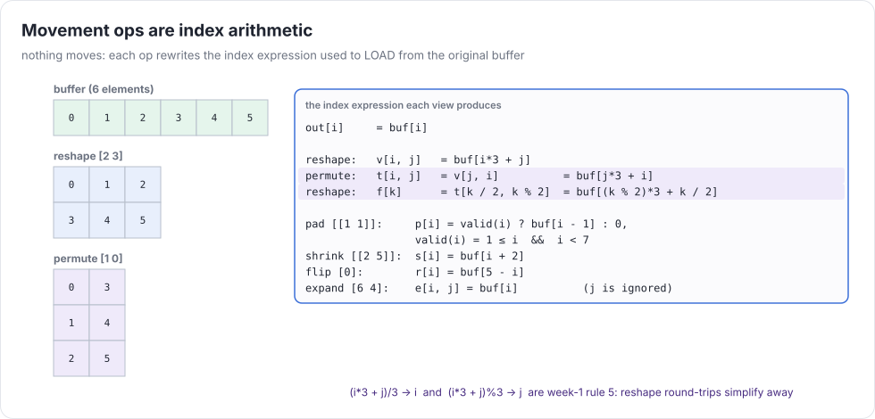
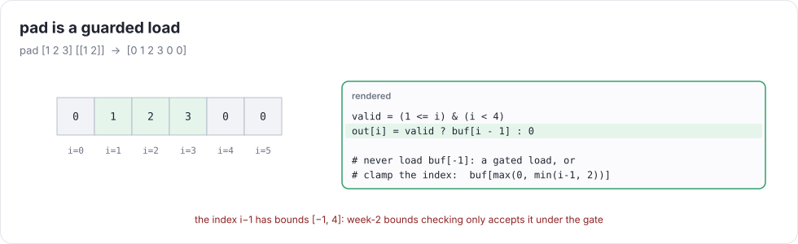
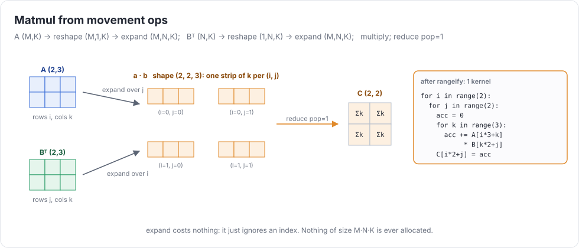

# Week 5 — Movement ops

> **Goal of the week:** `reshape`, `permute`, `expand`, `pad`, `shrink`, `flip`, and rank > 1, all **free**:
> none of them copies data. A movement op only changes the *index expression* used to load from the original buffer.
> Matmul, convolution, and pooling then become one-kernel compositions of movement ops, an ALU op, and a reduce.

---

## Lecture 5.1 — Views as index arithmetic

In rangeify (week 4), every op answers "given my output indices, how are my sources indexed?" Movement ops are the
ops that answer with pure arithmetic and nothing else:



| op | output index `(i…)` reads source index |
|---|---|
| `reshape x S` | flatten `(i…)` row-major in `S`, unflatten in `x.shape`: `/` and `%` |
| `permute x p` | `src[p[d]] = i[d]` |
| `expand x S` | axes of size 1 read index 0 (a scalar reads `()`) |
| `pad x [[b a]…]` | `i - b`, **valid** only when `b ≤ i < b + dim` (else the value is 0) |
| `shrink x [[s e]…]` | `i + s` |
| `flip x axes` | `dim - 1 - i` on the flipped axes |

Compose them by substituting, the same way you'd compose functions. That's all a "view" is. Because each op is
a pure index transformation, any chain of movement ops on top of a buffer costs **zero kernels and zero bytes**,
until something reads it (`movement_free.uir`: `# max-kernels: 1`).

### Two designs: strides vs. expressions

The classic design (NumPy, PyTorch, tinygrad's old `ShapeTracker`) represents a view as `shape + strides + offset + mask`.
`permute` permutes strides. `expand` sets a stride to 0. `shrink` moves the offset. `pad` adds a mask.
But `reshape` after `permute` is generally **not** expressible as one strided view, and then you need a *stack* of
views and merge rules.

The design this course recommends (newer tinygrad, Halide-style) skips all that. Keep **index expressions** (UOps!)
and compose by substitution. `reshape` produces `/` and `%`, and the week-1 simplifier removes them when they cancel.
No view-merging code. Correctness of a reshape becomes a theorem your simplifier proves:

```
reshape [12] → [4 3] → [12] → [4 3]   at index (i, j):
   x[((i*3 + j) / 3), ((i*3 + j) % 3)]   →  (rule 5, with j ∈ [0, 2])  →   x[i, j]
```

That's `index_math_simplifies.uir`, and why week 1 made you implement rule 5 soundly.

### pad, validity, and bounds



`pad` is the one movement op that introduces a **condition**. The source index `i - 1` has bounds `[-1, n]`, and week 2's
bounds checker (correctly) rejects it. Two fixes, both fine:

* **Gated load:** `LOAD(buf, idx, gate)` returns 0 when the gate is false, and the bounds check only needs `idx` in range
  *under* the gate. Implement this with intervals refined by the gate: from `1 ≤ i`, derive `i - 1 ≥ 0`.
* **Clamped index + select:** `where(valid, load(buf, clamp(i - 1)), 0)`. The clamp makes the bounds trivially fine.

Gated loads come back in week 8 (GPU kernels with predicated loads) and week 9 (tensor-core tiles at matrix edges).

---

## Lecture 5.2 — Matmul, convolution, and pooling from movement ops

### Matmul in one kernel



```
%a = expand (reshape %A [M 1 K]) [M N K]
%b = expand (reshape (permute %B [1 0]) [1 N K]) [M N K]
%C = reduce (mul %a %b) op=add pop=1
```

Rangeify gives output ranges `(i, j)` and a reduce range `k`. The `expand`s make `a` ignore `j` and `b` ignore `i`, the
`permute` swaps `B`'s indices, and the result is week 3's matmul loop nest, generated. Nothing of size `M·N·K` is ever
allocated (`matmul.uir`: one kernel).

### Pooling with reshape

A 2×2 max-pool over `(H, W)` is `reshape [H/2 2 W/2 2] → permute [0 2 1 3] → reduce pop=2 max` (`maxpool.uir`).
Reshape splits each axis into (block, offset), permute moves the offsets last, reduce eats them.

### Convolution

Two routes, both in the tests:

* **Sum of shifted views** (`conv2d_shifts.uir`): pad, then 9 shrinks, then 9 adds. Fine for 3×3. The kernel count stays 1.
* **Windows + matmul** (`im2col_conv.uir`): build `windows[oy, ox, ky·kx]` with shrinks and pads, then reduce
  against the flattened filter. This is *im2col* without materializing the columns, unless you ask for it with `contiguous`.

Week 6's `conv2d` in the Tensor API uses the general form: pad, then a **strided window view** built from
`reshape`/`expand`/`shrink`/`permute` (tinygrad's `_pool`). Work it out on paper this week. It's the hardest index
puzzle in the course, and it's all movement ops.

---

## Lecture 5.3 — The cost of index math

Free is relative. Each movement op adds arithmetic to the load address:

* `reshape` adds `/` and `%`. Integer division is slow (20–90 cycles on CPUs, many instructions on GPUs) unless the
  simplifier cancels it, or the divisor is a power of two (`>>`, `&`), or a constant (clang emits a multiply-shift).
* `pad` adds compares and a select per load.
* `flip` and `shrink` are cheap adds.

So "index arithmetic is free" really means "it's cheap compared to DRAM traffic". That holds for memory-bound kernels.
It can hurt compute-bound ones. Week 7 measures it. Make sure every generated index goes through the simplifier and
look at the C (`DEBUG=2`). An expression like `((i*3+j)/3)*3 + (i*3+j)%3` should never survive to the backend.

### Common mistakes that compound

* Implementing movement ops by copying. Correct, and four kernels where there should be one.
* A stride-based design without view merging. Correct, until `reshape(permute(x))` gives wrong answers.
* `pad` without validity, reading `buf[-1]`. In C it's UB that usually "works". On a GPU it's a crash.
* Skipping simplification of generated indices. The tests pass, and week 7's performance targets don't.

### Further reading

* van der Walt et al., *The NumPy Array: A Structure for Efficient Numerical Computation* (2011): strides
* tinygrad's `shape/view.py` (the old ShapeTracker) and `schedule/rangeify.py` (the new way): compare them
* Chellapilla et al., *High Performance Convolutional Neural Networks for Document Processing* (2006): im2col
