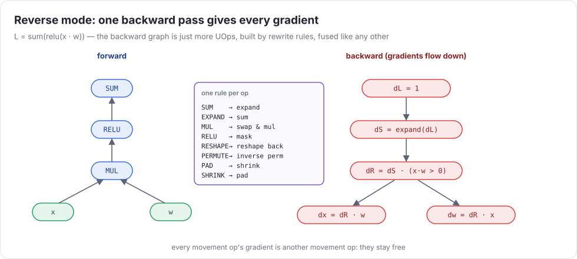
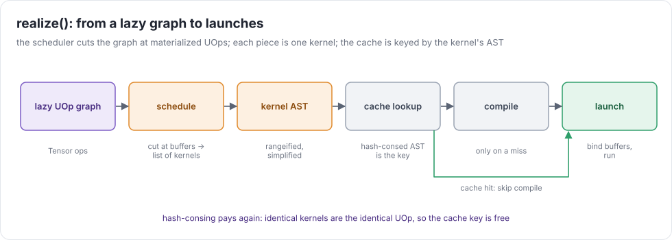
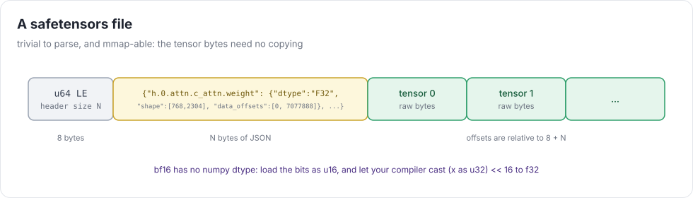

# Week 6 — Autodiff & speed

> **Goal of the week:** a lazy `Tensor` front end ([API](../tensor-api.md)), reverse-mode automatic differentiation
> as a graph transformation, weights loaded from disk, and enough speed to **train MNIST** and **run GPT-2 and ResNet-18**.

This is the week uc becomes a deep-learning framework. Almost nothing here is new compiler machinery. It's weeks 1–5
used from a nicer API. The new idea is autodiff, and it's one more graph rewrite.

---

## Lecture 6.1 — The lazy Tensor

```python
class Tensor:
  def __init__(self, data, dtype=None, device=None, requires_grad=False):
    self.uop = ...            # a BUFFER (for data) or any UOp graph
    self.requires_grad, self.grad = requires_grad, None
  def __add__(self, other): return Tensor._from(add(*broadcast(self, other)))   # builds graph, runs nothing
  def realize(self): ...      # schedule + compile + run; afterwards self.uop is a BUFFER
  def numpy(self): return self.realize()._buffer_as_numpy()
```

A `Tensor` is a thin, mutable handle around an immutable UOp. Every method builds graph. `realize()` runs week 4's
scheduler on the tensor's graph, and afterwards **replaces the handle's UOp with the output buffer**. Later uses then
load from memory instead of recomputing (`test_realized_value_not_recomputed`).

### Broadcasting lives in the front end

NumPy rules: align shapes on the right, and size-1 axes stretch. The front end inserts `reshape` + `expand` so the IR
still sees identical shapes. Python scalars become `CONST` UOps expanded to the other operand's shape. That
keeps "is this tensor a constant?" a pattern match, so `x * 1.0` can fold.

### Composite ops are just Python

`softmax`, `layernorm`, `cross_entropy`, `conv2d`, and `scaled_dot_product_attention` are all a few lines of Tensor code
over the primitives:

```python
def softmax(self, axis=-1):
  m = self - self.max(axis, keepdim=True)          # numerical stability
  e = m.exp()
  return e / e.sum(axis, keepdim=True)
def exp(self): return (self * (1 / math.log(2))).exp2()   # the IR only has exp2/log2: they're what the hardware has
```

`conv2d` is week 5's pool-and-reduce with a reshape trick, `pad → window view → (N, Cout, OH, OW, Cin·kh·kw)`.
That's one kernel when fused, and the shape of the problem that week 9's implicit GEMM will speed up.

### assign is versioned memory

`a.assign(b)` overwrites `a`'s buffer in place. Optimizers and weight loading need it. What about a tensor built
**before** the assign that hasn't been realized yet (`test_assign_is_versioned`)? It must see the old value. That's
exactly week 2: `assign` is a `STORE` that creates a new version of `a`'s buffer, and old users keep pointing at the
old version. The WAR machinery (realize old users first, or copy) does the rest. **If you built week 2 properly, this is
ten lines.**

---

## Lecture 6.2 — Reverse-mode automatic differentiation

### The idea

For `L = f(g(h(x)))`, the chain rule multiplies Jacobians. *Forward mode* pushes tangents from inputs to outputs
(one pass per input). *Reverse mode* pulls **cotangents** (`∂L/∂node`) from the output back to the inputs: one pass for
**all** inputs. With millions of parameters and one scalar loss, reverse mode is the only sensible choice.



### As a graph transformation

```python
def gradient(loss: UOp, leaves: list[UOp]) -> dict[UOp, UOp]:
  grads = {loss: const_like(loss, 1.0)}
  for u in reversed(loss.toposort()):           # every user before its sources
    if u not in grads: continue
    for src, g in zip(u.src, vjp(u, grads[u])):  # one rule per op
      if g is not None: grads[src] = grads[src] + g if src in grads else g
  return {l: grads.get(l) for l in leaves}
```

The rules (`vjp(u, g)` returns the cotangent for each source):

| op | cotangents |
|---|---|
| `a + b` | `g`, `g` |
| `a * b` | `g·b`, `g·a` |
| `-a`, `recip a` | `-g`, `-g·a⁻²` |
| `exp2 a`, `log2 a`, `sqrt a`, `sin a` | `g·out·ln2`, `g/(a·ln2)`, `g/(2·out)`, `g·cos a` |
| `max a b` | `g` where `a` wins, `g` where `b` wins. **Ties split** (`test_max_ties`) |
| `where c a b` | none, `where(c, g, 0)`, `where(c, 0, g)` |
| `cast` | cast `g` back (no gradient through int/bool) |
| `reduce add` | `expand(g)` back to the input shape |
| `reduce max` | `expand(g) · (x == expand(out))`, divided by the tie count |
| `reshape` / `permute` | `reshape` back / inverse `permute` |
| `expand` | `reduce add` over the expanded axes |
| `pad` / `shrink` | `shrink` / `pad` |
| `flip` | `flip` |

Some things to notice:

* **Gradients of movement ops are movement ops.** They stay free and fuse.
* The backward graph is ordinary UOps. Rangeify, fusion, and the simplifier treat it like any other graph:
  `relu`'s mask, `g·b`, and the reduce fuse into one backward kernel.
* **Accumulation:** a node used twice gets two contributions, summed (`test_reused_node_accumulates`). The `.grad` of a
  leaf accumulates across `backward()` calls until you zero it (torch semantics).
* Hash-consing helps here too: identical sub-gradients are one node.

### Checking gradients

The tests compare with PyTorch through the shim. When a gradient is wrong, check it numerically before staring at
the code. Use central differences in f64 (numpy) on a tiny input, `(f(x+h) - f(x-h)) / 2h` with `h ≈ 1e-3`,
and compare per element.

---

## Lecture 6.3 — Speed, disk, and real models

### Kernel fusion and the compile cache

`test_fusion.py` checks that your scheduler fuses what it should (an elementwise chain = 1 kernel, matmul + relu = 1,
softmax ≤ 3), and that **identical kernels are compiled once**. The cache key is the kernel's AST, the
hash-consed UOp after rangeify. Buffers must be *parameters* of the kernel (not baked-in addresses), so two kernels that
differ only in which buffers they touch share one compiled function.



### Reading weights



safetensors is 8 bytes of header length, a JSON header (name → dtype, shape, byte range), then raw bytes. Read it
with `np.memmap` or `mmap`, and make each tensor a `BUFFER` pointing into the mapping. A 500 MB checkpoint then costs
nothing until it's used. **bf16** has no numpy dtype: load the bits as `u16`, and let a uc kernel cast them,
`f32 = bitcast((u32)bits << 16)`. This is your first `BITCAST` UOp.

### Three models

* **MNIST** (`uc.models.mnist`): an MLP and a small CNN, trained with AdamW. The test asks for 96% / 98% test accuracy
  after 1000 steps. Write the training loop first with the shim (`UC_TORCH_SHIM=1`), then on uc.
* **GPT-2** (`uc.models.gpt2`): HF's checkpoint stores `Conv1D` weights as `(in, out)`, so transpose them when loading.
  The tiny-config test compares logits with `tests/ref/gpt2_torch.py`. The real 124M test runs if you've downloaded the weights.
* **ResNet-18** (`uc.models.resnet`): attribute names must mirror torchvision (`layer1[0].conv1`), so `load_state_dict`
  works by name. BatchNorm in eval mode is an affine transform: fold it into the conv weights as a stretch goal.

### What to profile

`DEBUG=1` should print one line per kernel launch: name, shape, time, and GFLOP/s or GB/s. Run GPT-2 with it.
Count kernels per layer and compare with what you'd write by hand. Find the slowest kernel and look at its C (`DEBUG=2`).
That's week 7's starting point.

### Common mistakes that compound

* `realize()` that doesn't replace the handle's UOp with the buffer, so every use recomputes the whole history.
* Eager evaluation hidden somewhere (calling `.numpy()` inside an op): it kills fusion silently. Watch kernel counts.
* Gradient rules that materialize (e.g. `expand` backward by building a full tensor of ones): correct, and 10× slower.
* Embedding lookup by one-hot matmul: correct, and ruinous at a vocabulary of 50k. Use a gather (a `LOAD` at a data-dependent index, clamped for bounds).

### Further reading

* Baydin et al., *Automatic Differentiation in Machine Learning: a Survey* (JMLR 2018)
* Griewank & Walther, *Evaluating Derivatives*, ch. 3–4
* The safetensors format (huggingface/safetensors README)
* Karpathy, *micrograd* (a scalar autograd in ~100 lines) and *nanoGPT* (GPT-2 in ~300)
