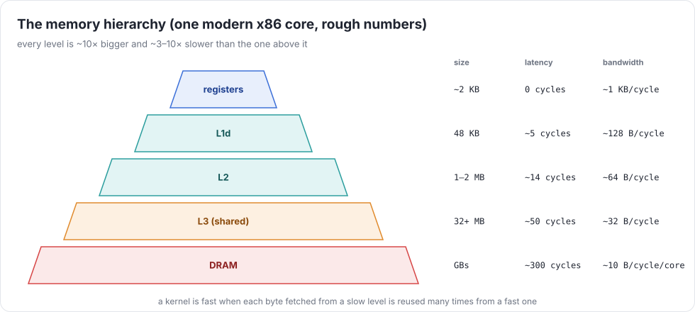
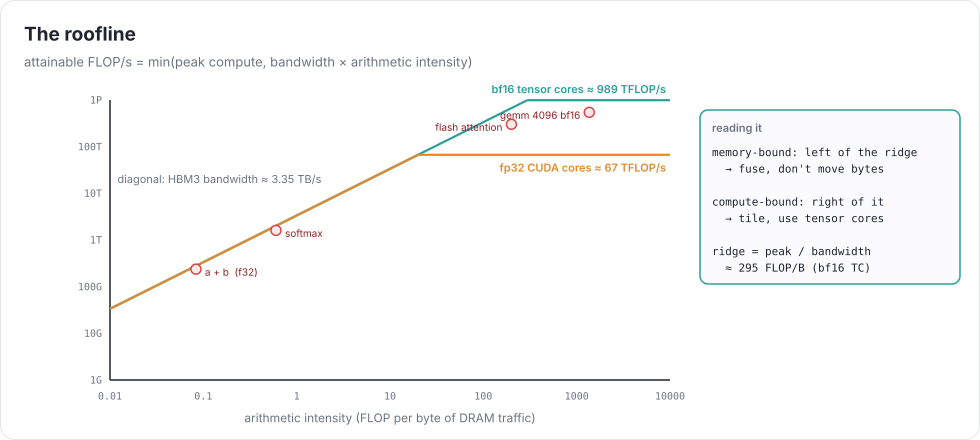
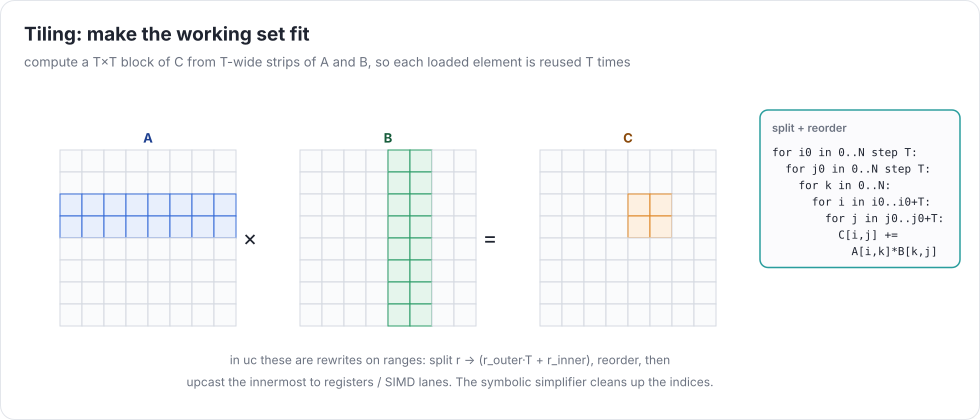

# Week 7 — Memory hierarchies, kernels, and threading

> **Goal of the week:** kernel optimizations expressed as **rewrites on a kernel's ranges** (split, reorder, unroll,
> upcast, parallelize), a way to choose them (heuristics, then search), and CPU kernels within a small factor of
> numpy/OpenBLAS. Take the time to measure carefully: this week is as much about benchmarking as about code.

---

## Lecture 7.1 — Why your kernels are slow



A modern core can do ~32 f32 FLOPs per cycle (two 8-wide FMA units at AVX2 rates, more with AVX-512), but it can
only fetch ~10 bytes per cycle from DRAM. One FMA on two fresh f32 operands needs 8 bytes. Unless data is reused from
cache or registers, the core spends most of its time waiting.

### The roofline



**Arithmetic intensity** (AI) = FLOPs / bytes moved from DRAM. Attainable performance = `min(peak, AI × bandwidth)`.

| kernel | AI (f32) | bound by |
|---|---|---|
| `c = a + b` | 1 / 12 | memory: 3 × 4 bytes per FLOP |
| `sum(a)` | 1 / 4 | memory |
| softmax over rows | ~1 | memory: fusion is the only optimization that matters |
| `N×N` matmul | up to `N / 6` | compute, *if* each loaded element is reused ~N times |

Measure before optimizing. `benchmarks/roofline.py` prints GFLOP/s and GB/s per kernel, using `stats.flops` and
`stats.bytes` from your runtime. Find your machine's two roofs with a STREAM-like copy and a register-only FMA loop.

### What the hardware rewards

* **Cache lines** (64 B): touching one float loads 16. Walk memory contiguously (stride 1 in the innermost loop).
* **Reuse distance:** the same data, used again soon, comes from L1. **Tiling** shortens reuse distance.
* **SIMD:** one instruction on 8 (AVX2) or 16 (AVX-512) floats. The innermost loop over contiguous data should vectorize.
* **Independent work:** an FMA has ~4 cycles of latency. With one accumulator, you're latency-bound at ¼ of peak.
  With 8–12 independent accumulators (register tiling), you're throughput-bound.
* **Cores:** threads multiply everything above, if the work splits without sharing cache lines.

---

## Lecture 7.2 — Optimizations are rewrites on ranges

A kernel after rangeify is a loop nest: output ranges and reduce ranges. Every classic loop optimization is a small
rewrite of those ranges, and the week-1 simplifier cleans up the index math afterwards.

| action | rewrite | effect |
|---|---|---|
| `split(r, T)` | `r → r_o·T + r_i`, `r_o ∈ [0, N/T)`, `r_i ∈ [0, T)` | creates tile loops |
| `reorder` | change the loop nesting order | locality |
| `unroll(r)` | replace `r` by T copies of the body with `r = 0…T-1` | removes loop overhead, exposes ILP |
| `upcast(r)` | like unroll, but the T values become a **vector** (`float8`) or T accumulators | SIMD and register tiling |
| `parallel(r)` | iterations of `r` go to different threads | cores |



### A matmul, step by step

```
start:        for i, j:  acc = 0; for k: acc += A[i,k]·B[k,j];  C[i,j] = acc
split i, j:   for i_o, j_o, i_i(4), j_i(8): … for k: …
upcast i_i,j_i → 4×8 register tile: 32 accumulators, B row loads as float8 vectors
reorder:      for i_o, j_o: for k: for i_i, j_i (upcast): acc[i_i][j_i] += A[i_o·4+i_i, k] · B[k, j_o·8+j_i]
parallel i_o
```

That's the micro-kernel structure from Goto & van de Geijn. Each iteration of `k` loads 4 values of `A` and 8 of `B`
(one vector) and does 32 FMAs. Add a `k` split for an L1/L2 tile, and you're in the neighborhood of BLAS.

### Vectors in the IR

Give dtypes a vector width: `f32.vec(8)`. An `UPCAST` of a range of size 8 turns the scalar UOps that depend on it
into vector UOps. `LOAD` of 8 contiguous addresses becomes one vector load. A `REDUCE` over an upcast axis becomes a
horizontal reduction. Render with clang's vector extensions:

```c
typedef float float8 __attribute__((ext_vector_type(8)));
float8 b = *(float8*)(B + k*N + j0);           // contiguous: one vector load
acc0 += a0 * b;                                 // 8 FMAs
```

Contiguity must be *proven*: the index must be `base + lane` with `base` a multiple of 8. Otherwise, gather 8 scalars.
That's another proof obligation for your simplifier (week 1, again).

### Correctness: fuzz the optimizer

Every optimization must leave results unchanged. `UC_OPT_FUZZ=seed` applies a random sequence of *legal* actions to
every kernel. `test_opts_correct.py` runs eight seeds on awkward shapes (37×53×29: remainders everywhere).
Legal means: a split's factor divides the range (or you emit a remainder loop or a guard), reduce ranges aren't parallelized
naively, and upcasts are ≤ 32 wide.

---

## Lecture 7.3 — Threads and search

### Threads

Parallelize the outermost output range. The simplest runtime: a persistent pool of N pthreads, and kernels compiled as
`void kernel(int tid, int nthreads, …)` that split `r_o` into chunks. Two traps:

* **Reductions over all elements** (`sum` to a scalar) have no output range to split. Split the reduce
  instead: each thread reduces a chunk into `partial[tid]`, then a second (tiny) kernel sums the partials.
  This *two-stage reduction* is exactly what you'll do on GPUs next week.
* **False sharing:** threads writing adjacent floats fight over one cache line. Give each thread whole cache lines.

OpenMP (`#pragma omp parallel for`, `-fopenmp`) is fine too, and is fewer lines. Know what it does for you.

### Choosing optimizations

* **Heuristics first:** upcast the two output axes of a matmul-like kernel to a 4×8 or 8×8 tile, vectorize the
  contiguous axis, parallelize the outermost axis, unroll small reduce loops. Five rules get you most of the way.
* **Then search** (`UC_BEAM=n`): enumerate legal actions, compile and time each candidate on the real inputs, keep the best
  `n`, repeat until nothing improves. Cache the winner by the kernel's AST, so search happens once per kernel shape.
  Compile in parallel. Time with warmup and the minimum of several runs.

Search is how tinygrad, TVM, and Ansor beat hand heuristics on shapes nobody tuned for. It's also slow, so it must be
optional and cached.

### Targets (relative to numpy on your machine)

| benchmark | target |
|---|---|
| sgemm 1024 | ≥ 25% of numpy (OpenBLAS / Accelerate). ≥ 50% is very good |
| add 16M | ≥ 50% |
| sum 16M | ≥ 50% |
| softmax 4096×1024 | ≥ 100%: numpy makes 4 passes over memory, you make 2 |

### Common mistakes that compound

* Optimizations that rewrite the *rendered C* instead of the UOps. They can't be fuzzed, searched, or reused for CUDA.
* Upcasting without proving contiguity, which reads garbage at tile edges.
* A beam search without a cache, so the test suite takes an hour.
* Timing without warmup or with debug output on.

### Further reading

* Goto & van de Geijn, *Anatomy of High-Performance Matrix Multiplication* (TOMS 2008)
* Williams, Waterman & Patterson, *Roofline* (CACM 2009)
* Drepper, *What Every Programmer Should Know About Memory* (2007), sections 3 and 6
* Chen et al., *Learning to Optimize Tensor Programs* (TVM/AutoTVM, NeurIPS 2018)
