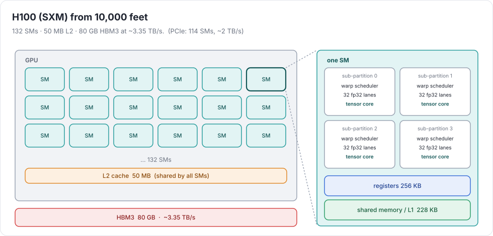
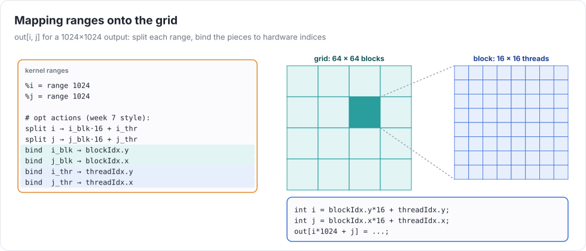
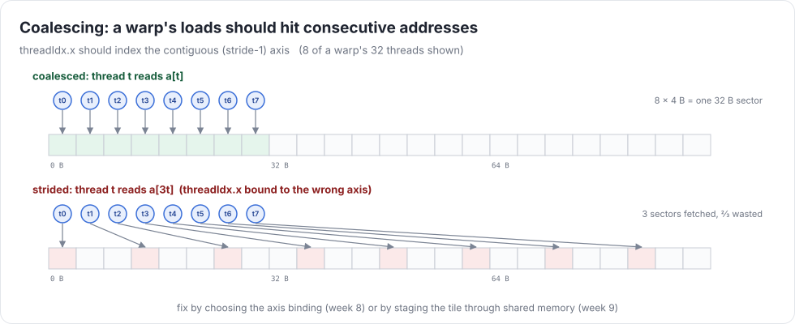

# Week 8 — GPUs & hardware accelerators

> **Goal of the week:** a CUDA backend written from scratch (NVRTC to compile, the driver API through `ctypes` to
> launch), ranges mapped onto the grid, and kernels that are **competitive**: ≥ 80% of PyTorch on bandwidth-bound ops
> and ≥ 50% on FP32 GEMM, on an H100.

Everything from week 7 carries over: optimizations are range rewrites, and the GPU is a different set of hardware
axes to bind them to.

---

## Lecture 8.1 — The GPU execution model



* A **thread** runs your kernel body for one point of the iteration space.
* 32 threads form a **warp**. A warp issues one instruction at a time for all 32 lanes (SIMT). Divergent branches
  serialize.
* Warps are grouped into **blocks** (CTAs, up to 1024 threads). A block runs on one **SM** and shares its
  **shared memory** (up to 228 KB per SM on H100). Threads in a block can `__syncthreads()`.
* Blocks form the **grid**. Blocks can't synchronize with each other inside a kernel. That's why our kernel
  definition (week 4) has independent outer loops.

Latency hiding is the core idea. A global load takes ~500+ cycles. Instead of caches and out-of-order execution,
the GPU keeps many warps resident (**occupancy**) and switches to a ready one every cycle. Registers and shared memory
per thread limit how many warps fit, so "use more registers" and "have more warps" trade off.

H100 SXM numbers to keep in your head: 132 SMs, ~3.35 TB/s HBM3, 50 MB L2, ~67 TFLOP/s FP32 on CUDA cores,
~989 TFLOP/s dense BF16 on tensor cores (week 9). The PCIe card has 114 SMs and ~2 TB/s.

---

## Lecture 8.2 — A CUDA backend from scratch

### Compiling and launching without PyTorch

```python
nvrtc = ctypes.CDLL("libnvrtc.so"); cuda = ctypes.CDLL("libcuda.so")
check(cuda.cuInit(0)); check(cuda.cuDeviceGet(byref(dev), 0)); check(cuda.cuCtxCreate(byref(ctx), 0, dev))

prog = ctypes.c_void_p()
check(nvrtc.nvrtcCreateProgram(byref(prog), src.encode(), b"k.cu", 0, None, None))
opts = [b"--gpu-architecture=sm_90", b"-default-device", b"--use_fast_math=false"]
check(nvrtc.nvrtcCompileProgram(prog, len(opts), (c_char_p * len(opts))(*opts)))   # on error, print the log
... nvrtcGetPTXSize / nvrtcGetPTX ...
check(cuda.cuModuleLoadData(byref(mod), ptx)); check(cuda.cuModuleGetFunction(byref(fn), mod, b"kernel"))
check(cuda.cuLaunchKernel(fn, gx, gy, gz, bx, by, bz, smem, stream, kernel_params, None))
```

About 150 lines covers context, memory (`cuMemAlloc`, `cuMemcpyHtoD/DtoH`), modules, launches, events for timing, and
error strings. Generate the `ctypes` declarations by hand from `cuda.h`: it's tedious, and you'll understand every
call your runtime makes. (AMD: the same structure with `hiprtc` and `libamdhip64`. The renderer barely changes.)

### Rendering CUDA

The C renderer, plus: `extern "C" __global__ void kernel(float* __restrict__ b0, …)`; `blockIdx`/`threadIdx` as special
UOps (`SPECIAL` with an axis and a size); `__shared__` buffers (`DEFINE_LOCAL`); `__syncthreads()` as a `BARRIER` UOp; and
`__ldg`, `__shfl_xor_sync`, and `half`/`__nv_bfloat16` as needed.

### Mapping ranges to the grid



Binding is one more optimization action: `bind(r, blockIdx.x)`. A range bound to a hardware index stops being a loop.
Its UOp is replaced by `blockIdx.x * BLOCK + threadIdx.x`, plus a guard when the size isn't a multiple. Defaults:

* elementwise: flatten all output ranges, split into `(blocks, 256 threads)`, upcast 4 for `float4` loads.
* matmul-like: 2-D blocks over `(i, j)`, threads over a sub-tile, a register tile per thread (week 7's upcast).
* gridDim.y and .z are limited to 65535: map the big axis to `.x` (`test_big_grid`).

### Coalescing



The 32 loads of a warp are served together when they hit contiguous memory. Bind `threadIdx.x` to the axis whose stride
is 1 in the *most-read* buffer. When two buffers disagree (a transpose), stage a tile through shared memory: read
coalesced, `__syncthreads()`, write coalesced.

---

## Lecture 8.3 — Competitive kernels

**Elementwise** (target: ≥ 80% of torch): grid-stride or one element per thread with 4-wide vectors, enough blocks to
fill 132 SMs several times over. That's it. If you're at 50%, look at the vector width and the index math in the SASS
(`cuobjdump -sass`).

**Reductions** (≥ 70%): a two-stage design. Stage 1: each block reduces a contiguous chunk. Each thread accumulates
several elements serially (`upcast`), then a warp reduces with `__shfl_xor_sync` (5 steps for 32 lanes), then warp
results go through shared memory, then one write per block. Stage 2: one block reduces the partials. Sizes that aren't
a multiple of the block size (`test_reduce_sizes`) need guards with the reduction's identity.

**Softmax** (≥ 60%): one block (or warp) per row. Max, exp-and-sum, and divide in one kernel with the row in
registers or shared memory, so each element is read from HBM once. Week 4's materialization policy would make this three
kernels. Teach the scheduler that a reduce whose consumers are all in the same row can stay **inside** the kernel
(a block-level reduction). This is the first GPU-specific scheduling rule.

**SGEMM without tensor cores** (≥ 50% of torch FP32 with TF32 off): blocks of 128×128 outputs, a K-loop with tiles of
A and B staged in shared memory, each thread computing an 8×8 register tile from shared memory, vectorized global
loads. It's week 7's schedule, mapped to the GPU's levels.

### Profiling

`ncu --set full python -m pytest tests/week08/test_cuda_perf.py::test_sgemm` shows achieved bandwidth, occupancy,
warp stall reasons, shared-memory bank conflicts, and the roofline. Read *one* report fully this week. "Stall long
scoreboard" means waiting on global memory: more parallelism or prefetching. "Stall MIO throttle" means too much shared
memory traffic: bigger register tiles.

### Common mistakes that compound

* Launching one thread per output with no upcast. You're limited by instruction overhead, not memory.
* Forgetting the guard when the size isn't a multiple of the block, which silently writes past the end.
* `--use_fast_math` "for speed": wrong nan, inf, and denormal behavior, and differential tests fail.
* Synchronizing the device after every launch. Timing should use events. Only `.numpy()` needs to synchronize.

### Further reading

* NVIDIA CUDA C++ Programming Guide, ch. 5 (programming model) and the performance guidelines
* NVIDIA NVRTC and CUDA Driver API reference
* NVIDIA H100 Tensor Core GPU Architecture whitepaper
* Simon Boehm, *How to Optimize a CUDA Matmul Kernel for cuBLAS-like Performance* (blog)
