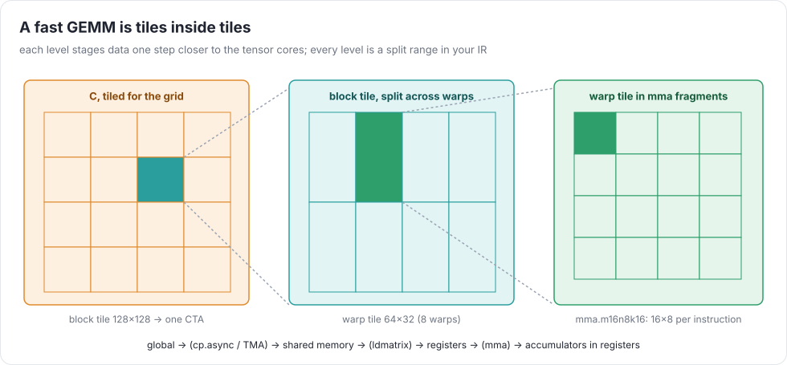
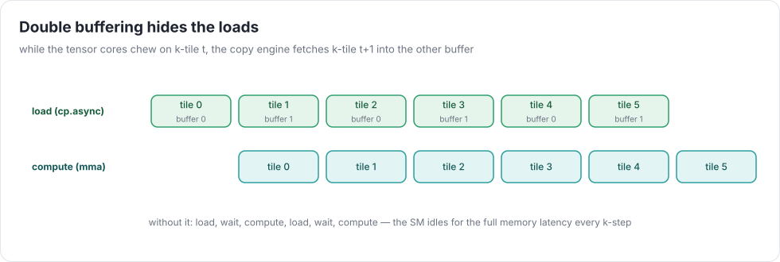
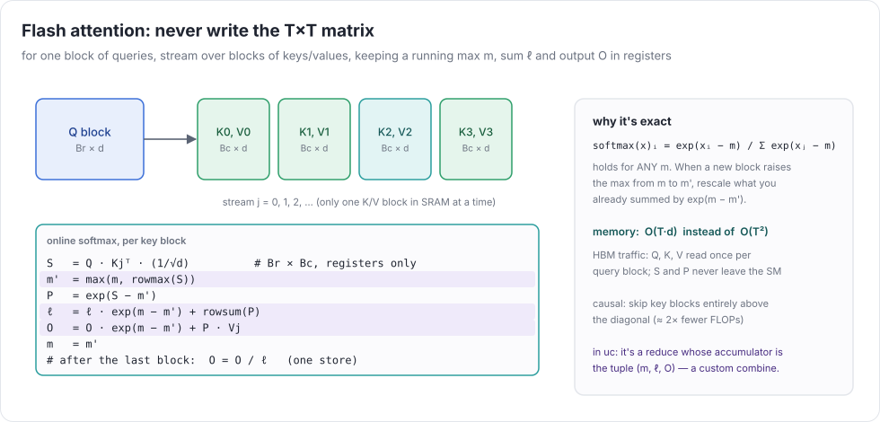

# Week 9 — GPUs part 2: tensor cores, fast GEMM, convolutions, flash attention

> **Goal of the week:** f16 / bf16, tensor-core matmuls from your own IR (≥ 50% of cuBLAS on an 8192² bf16 GEMM),
> convolution as implicit GEMM, and **flash attention** as one fused kernel that never writes the T×T matrix.

---

## Lecture 9.1 — Tensor cores

A tensor core multiplies small matrix tiles per instruction. On Hopper, a warp's `mma.sync.aligned.m16n8k16`
computes a 16×8 tile of `C += A(16×16) · B(16×8)` in bf16/f16 with f32 accumulation. The newer **`wgmma`**
instructions let a *warpgroup* (4 warps) issue 64×N×16 MMAs asynchronously, straight from shared memory. That's what
cuBLAS uses to approach ~989 TFLOP/s.

| path | what you write | ceiling on H100 (rough) |
|---|---|---|
| WMMA C++ API (`nvcuda::wmma`) | fragments, `load_matrix_sync`, `mma_sync` | low: easy, but limited control |
| PTX `mma.sync` + `ldmatrix` | register fragments with a fixed thread↔element layout | ~60–70% of cuBLAS |
| PTX `wgmma` + TMA | shared-memory descriptors, async, mbarrier pipelines | ~cuBLAS |

This week targets the middle row (≥ 50%). `wgmma` + TMA is the best stretch goal in the course.

### Tensor cores in the IR

Don't render MMA from pattern-matching C. Add a UOp: `WMMA(a_frag, b_frag, c_frag, arg=(M, N, K, dtype_in, dtype_acc))`.
It's created by an optimization action, `tc(reduce)`, which:

1. checks that the kernel is a matmul-shaped reduce (`REDUCE add` over `MUL(LOAD a, LOAD b)` with a reduce axis K
   and two output axes),
2. splits the ranges by 16 / 8 / 16 and **upcasts** them: the inner tile becomes the vector-typed fragment the
   instruction consumes,
3. replaces the inner `MUL` + `REDUCE` with `WMMA`.

The fragment layout (which thread holds which element) is specified in the PTX ISA. Encode it as the index
expression of the upcast axes, in terms of `threadIdx.x % 32`. Once more: index math, simplified by week 1.

### Half precision

* `f16`: 5-bit exponent, so it overflows at 65504. Fine for inputs, not for sums: always accumulate in f32.
* `bf16`: f32's 8-bit exponent with a 7-bit mantissa. It has the range of f32 and ~3 significant digits. It's the training default.
* Casts: `__float2bfloat16_rn` (round to nearest even). Test bit-exactness against torch (`test_bf16_roundtrip`).

---

## Lecture 9.2 — A fast GEMM, and convolutions



The hierarchy, as range splits:

| level | tile | lives in | your IR |
|---|---|---|---|
| grid | 128×128 (or 128×256) of C | — | `bind(i_o, blockIdx.y)`, `bind(j_o, blockIdx.x)` |
| k-loop | 64 of K per step | shared memory (A: 128×64, B: 64×128) | `split(k)`, `DEFINE_LOCAL` + copy |
| warp | 64×32 (8 warps) | registers | `bind(i_w, warp)` |
| instruction | 16×8×16 | fragments | `WMMA` |

### Shared memory without bank conflicts

Shared memory has 32 banks, 4 bytes wide. A warp reading a column of a row-major 64-wide tile hits one bank 32 times:
a 32-way conflict. Fixes: pad rows by 8 halves, or **swizzle**, XOR the column with the row (`col ^ (row % 8)`)
in the index expression. `ldmatrix` loads 8×8 sub-tiles in exactly the layout `mma` wants. Swizzling is just
another index rewrite, and your bounds checker should still prove every access in range.

### Pipelining



`cp.async` copies global → shared without going through registers, and lets the warp continue. With 2–4 stages,
the loads for k-tile t+1 (or t+3) overlap the MMAs for tile t. In the IR this is a `LOAD`/`STORE` pair moved one
iteration ahead, plus `cp.async.wait_group` barriers. Get it working with 2 stages before trying more.

### Epilogue fusion

`relu(A @ B + bias)` is one kernel since week 5. Keep it one kernel now: the elementwise tail operates on the f32
accumulators in registers before the single store. Cast to bf16 there too.

### Convolution as implicit GEMM

A conv with input `(N, C, H, W)` and filter `(K, C, R, S)` is a GEMM with `M = N·P·Q` (output pixels),
`N_gemm = K`, and `K_gemm = C·R·S`. Week 5's window view expresses exactly that. You don't need im2col in memory:
the A-tile loader computes `x[n, c, p·stride + r - pad, q·stride + s - pad]` from the GEMM's (m, k) indices, with
padding as a gated load. Your tensor-core action should then fire on conv kernels unchanged, as long as the index math simplifies.

---

## Lecture 9.3 — Flash attention

`softmax(QKᵀ/√d)·V` naively writes the `T×T` score matrix to HBM and reads it back twice: O(T²) memory and traffic.
For T = 64k, that's tens of gigabytes per head.



### Online softmax

For one row, `softmax(x)ᵢ = exp(xᵢ − m)/Σⱼ exp(xⱼ − m)` holds for **any** constant m. Process the keys in blocks and
keep a running max `m`, sum `ℓ`, and output accumulator `O`. When block j raises the max to `m'`, rescale what you
have by `exp(m − m')`:

```
S  = Q·Kⱼᵀ/√d;   m' = max(m, rowmax S);   P = exp(S − m')
ℓ  = ℓ·exp(m − m') + rowsum P
O  = O·exp(m − m') + P·Vⱼ;    m = m'
finally O /= ℓ
```

That's exact, not an approximation. One block of queries stays on the SM, keys and values stream through shared memory,
and S and P live in registers. Two tensor-core GEMMs per key block: `Q·Kᵀ` and `P·V`.

### In uc

There are two ways to get there. Pick one and write down why.

1. **A fusion rule:** recognize the `max → sub → exp → sum → div` and `matmul` pattern in the scheduled graph and replace
   it with a hand-written attention kernel template. It's quick, and it's not a compiler.
2. **A general reduce with a custom combine:** generalize `REDUCE` to carry a tuple accumulator `(m, ℓ, O)` and a combine
   function. Then softmax-times-V *is* a reduce over the key axis, and rangeify, tensor-core actions, and tiling apply
   as usual. It's harder, and it's how a compiler should do it.

Causal masking: skip key blocks entirely above the diagonal (half the FLOPs), and mask only the diagonal block.
With GQA, the K/V head index is `q_head // (H / H_kv)`: index math again.

The backward pass (week 11 training) recomputes S and P from Q, K, V and the saved `m`, `ℓ`. Don't save P.
FlashAttention-2 reorders the loops to parallelize over query blocks and cut non-matmul FLOPs. FlashAttention-3 uses
`wgmma`, TMA, and warp specialization on Hopper. Read both papers after your version works.

### Targets (H100, vs PyTorch)

bf16 GEMM 8192 ≥ 50% · conv 3×3 (ResNet-50 shape) ≥ 30% · causal flash attention ≥ 40% · T = 65536 runs in one kernel without running out of memory.

### Common mistakes that compound

* Accumulating in bf16. The error grows with K.
* A fragment layout guessed instead of read from the PTX ISA. Most entries are right and a few are silently wrong. Test a
  16×8×16 MMA alone against numpy first.
* Swizzling that breaks bounds proofs. Prove the XOR'd index stays in the tile.
* Flash attention that reads the whole K/V per query *row* instead of per query *block*. Correct, and 64× slower.

### Further reading

* NVIDIA PTX ISA: `mma`, `ldmatrix`, `cp.async`, `wgmma`, TMA (`cp.async.bulk.tensor`)
* Dao et al., *FlashAttention* (2022), *FlashAttention-2* (2023), Shah et al., *FlashAttention-3* (2024)
* Milakov & Gimelshein, *Online normalizer calculation for softmax* (2018)
* CUTLASS documentation: the GEMM hierarchy and CuTe layouts
