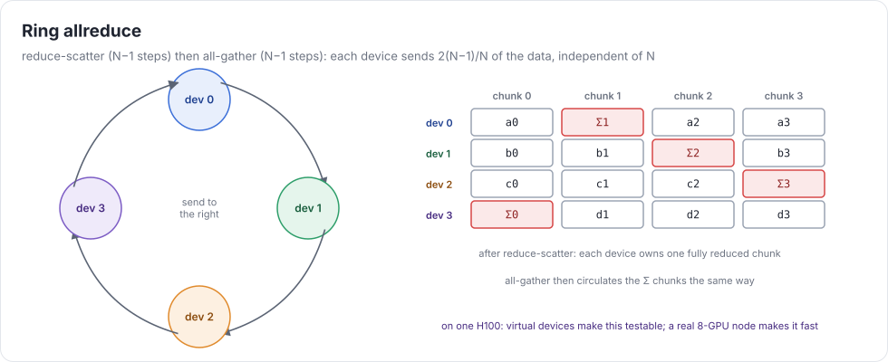
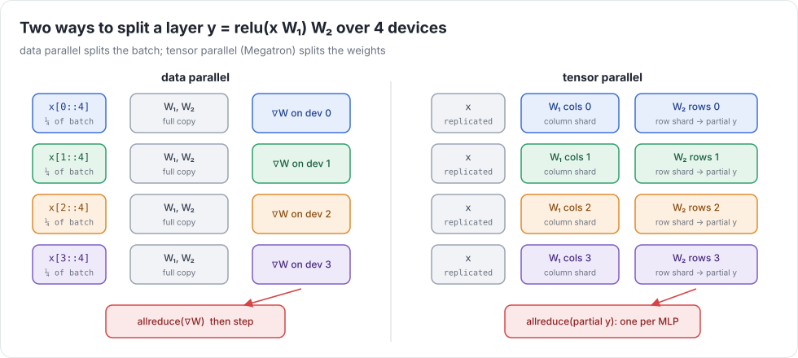

# Week 10 — Multiple GPUs and sharding

> **Goal of the week:** tensors that live on several devices at once (`x.shard(devices, axis)`), every op working on them,
> allreduce built from copies and adds, and data- and tensor-parallel training that matches single-device training.

**About hardware.** You have one H100. Everything this week is testable without more:

* **CPU devices** `CPU:0…CPU:3` have separate buffers. The tests use them by default.
* **Virtual GPUs:** `UC_VIRTUAL_GPUS=4` makes `CUDA:0…CUDA:3` four logical devices on one GPU, each with its own
  allocations and stream. Copies between them are real device-to-device copies. Correctness is fully exercised. Scaling isn't.
* **MIG** can split an H100 into up to 7 isolated instances. They can't talk to each other directly (no P2P, no NCCL),
  so they're good for isolation experiments and bad for allreduce.
* For real scaling numbers, rent an 8×H100 node for a few hours at the end of the week and run `benchmarks/` there.

---

## Lecture 10.1 — Communication

Four collectives cover almost everything:

| collective | input → output (N devices, data size D) | ring cost per device |
|---|---|---|
| all-gather | each has D/N → all have D | (N−1)/N · D sent |
| reduce-scatter | each has D → each has a reduced D/N | (N−1)/N · D |
| all-reduce | each has D → all have the reduced D | 2(N−1)/N · D |
| broadcast | one has D → all have D | — |



**Ring allreduce** is reduce-scatter followed by all-gather. Each device sends 2(N−1)/N · D bytes no matter how
large N is, which is why it's bandwidth-optimal. The α-β model, `time = α·messages + β·bytes`, tells you when a tree
(fewer messages, more bytes per link) is better: for small messages, where latency α dominates.

Links on an 8×H100 HGX: NVLink 4 at ~900 GB/s per GPU through NVSwitch. Over PCIe it's ~64 GB/s. Over a network,
less again. That's why the ratio of compute to communication decides which parallelism to use.

In uc, an allreduce is a **graph**: copies between devices plus adds. No NCCL. You build it from week 8's
device-to-device copy (`cuMemcpyPeerAsync`, or staged through host memory if P2P isn't available) and your own
kernels. Write the ring version. Then compare it with naive "everyone sends to device 0" for 2, 4, and 8 devices.

---

## Lecture 10.2 — Sharded tensors in the IR

A sharded tensor is a tuple of per-device UOps plus the sharded **axis** (or `None` for replicated):

```python
class MultiUOp:  srcs: tuple[UOp, ...];  axis: int | None;  devices: tuple[str, ...]
```

Propagation rules (`multi.py`):

| op | rule |
|---|---|
| elementwise, same axis | apply per shard |
| elementwise, different axes | **reshard** one operand (all-gather and re-split, or local shrink if it's replicated) |
| `reduce` over a non-sharded axis | per shard |
| `reduce` over the sharded axis | per-shard partial reduce, then **all-reduce** → replicated |
| `reshape` | per shard, if the sharded axis maps to one output axis and stays divisible; else gather first |
| `permute` | per shard; the axis moves |
| `expand`, `pad`, `shrink` | per shard when they don't touch the sharded axis |
| `matmul` sharded on the contraction axis | partial products + all-reduce (`test_matmul_sharded_k`) |

Uneven shards are an error this semester (`test_uneven_shard_is_an_error`). Real systems pad.

Autodiff needs no changes. Gradients of sharded tensors are sharded the same way, and the backward of an all-reduce
is an all-reduce (for sums). That's the payoff for making communication ordinary graph ops.

---

## Lecture 10.3 — Parallel training



* **Data parallel:** replicate weights, shard the batch, all-reduce gradients, step. It's the same math as one
  device (`test_data_parallel_equals_single_device`), as long as the loss is a *mean over the global batch*.
* **Tensor parallel (Megatron):** split W₁ by columns and W₂ by rows. Each device computes its slice of the hidden
  layer, and one all-reduce combines the partial outputs per MLP. Attention splits by heads the same way.
* **ZeRO / FSDP:** shard the optimizer state, gradients, and even the weights across data-parallel ranks. All-gather
  weights just before use and reduce-scatter gradients right after. Memory per GPU drops by about N×.
* **Sequence / context parallel, ring attention:** shard the sequence. Attention passes K/V blocks around the ring,
  and the online softmax from week 9 is exactly what makes partial results combinable.
* **Overlap:** start the all-reduce for layer L's gradients while computing layer L−1's backward. In uc, that's
  scheduling: run communication on its own stream and order kernels by dependence, not by program text.

### Common mistakes that compound

* All-reduce implemented with host round trips per element (100× slow), or blocking the default stream.
* Averaging gradients twice: once in the loss, once after the all-reduce.
* Resharding silently on every op (correct, slow). Log reshards in `DEBUG=1`.
* Testing only with `axis=0`. Shard on the axis you contract over.

### Further reading

* Shoeybi et al., *Megatron-LM* (2019) · Rajbhandari et al., *ZeRO* (2020)
* Patarasuk & Yuan, *Bandwidth Optimal All-reduce Algorithms* (2009)
* Liu et al., *Ring Attention with Blockwise Transformers* (2023)
* tinygrad's `multi.py`: sharded tensors in a few hundred lines
