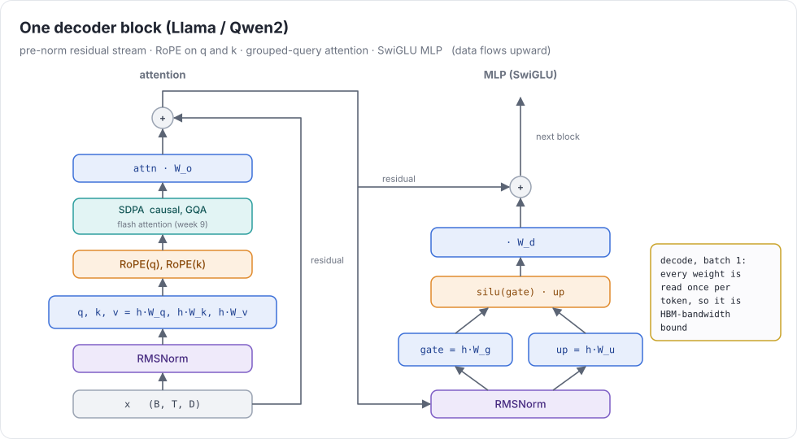
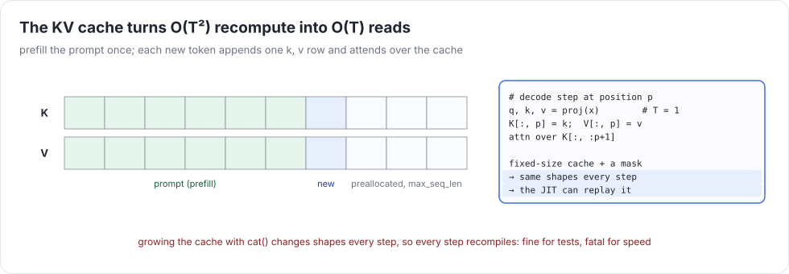
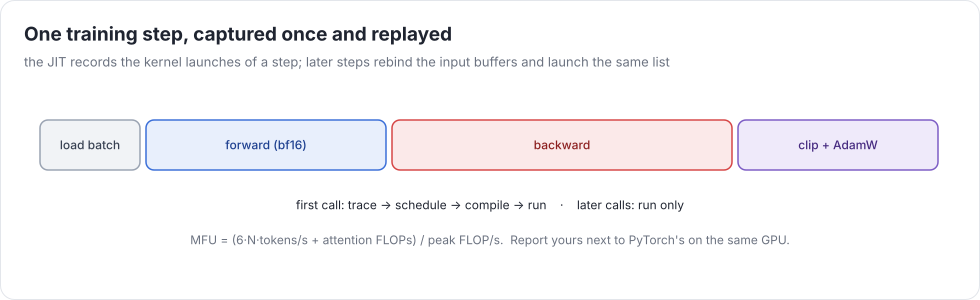

# Week 11 — SOTA inference and training

> **Goal of the week:** run a modern LLM (Qwen2.5-1.5B, a Llama-architecture model) at ≥ 50% of the memory-bandwidth
> bound, and train GPT-2 124M on FineWeb so that the loss curve matches PyTorch's, on your own compiler, on one H100.

No new IR this week. It's integration: everything from weeks 1–10 has to work together, fast, on real models.
Most of the bugs you hit this week are latent bugs from earlier weeks, now visible at scale.

---

## Lecture 11.1 — A modern decoder



Compared with GPT-2 (week 6):

| GPT-2 | Llama / Qwen2 |
|---|---|
| learned absolute positions | **RoPE**: rotate (q, k) pairs by position-dependent angles. Relative position falls out of the dot product |
| LayerNorm (mean and variance) | **RMSNorm**: no mean, no bias. Cheaper, and it fuses into one reduce |
| GELU MLP, 4× width | **SwiGLU**: `silu(x W_g) ⊙ (x W_u) W_d`, ~2.7× width |
| multi-head attention | **GQA**: several query heads share one K/V head. The KV cache shrinks by H/H_kv |
| tied embeddings | varies (Qwen2.5 small models tie; Llama 3 8B doesn't) |

`tests/ref/llama_torch.py` is the reference: functional, HF naming, "rotate-half" RoPE. HF checkpoints use the
rotate-half convention (pairs `(i, i + d/2)`), not the interleaved one from the original Meta code. Getting this wrong
gives plausible-looking garbage.

### The KV cache



Autoregressive decoding generates one token at a time. Without a cache, step t recomputes attention for all t
previous tokens. With a cache, step t computes q, k, v for **one** token, appends k and v, and attends over the cache.

### Decode is bandwidth-bound

At batch 1, every weight is read once per token and used for one multiply-add. Arithmetic intensity is ≈ 1 FLOP/byte
(bf16), far left on the roofline. The speed limit is:

```
tokens/s ≤ HBM bandwidth / bytes of weights  ≈  3.35 TB/s / 3.1 GB  ≈  1000 tok/s   (Qwen2.5-1.5B in bf16, H100 SXM)
```

Your target is 50% of that. The math is easy. The overheads are what kill you: 28 layers × ~15 kernels = 400+ launches
per token at ~3–5 µs each is already 1–2 ms, *more* than the 1 ms the bandwidth allows.

---

## Lecture 11.2 — Making inference fast

### The JIT: capture once, replay forever

```python
@jit
def decode_step(tok, pos): return model(tok, start_pos=pos).realize()
```

The first calls run normally while recording the list of `(kernel, buffers, launch dims)` they produce. Later calls
skip tracing, scheduling, and compiling: they **swap in the new input buffers and replay the launch list**. (On CUDA,
capture it into a **CUDA graph** to cut launch overhead further.) Requirements:

* **Same shapes every call.** A cache grown with `cat` changes shape every step. Use a **fixed-size cache**
  (`max_seq_len`) and a mask over positions `≤ start_pos`.
* **`start_pos` must not be baked into kernels.** Make it a **symbolic variable**: a `VAR` UOp with bounds
  `[0, max_seq_len)`, passed at launch. This is week 1's `var` again, now a runtime parameter. Every index
  that uses it still gets bounds-checked by week 1's intervals.

### Fusion that matters at batch 1

* RMSNorm + the following matmul's input read: one kernel.
* RoPE applied inside the q/k projection epilogue.
* **Flash decoding**: attention for one query over a long cache has too little parallelism for one block per head.
  Split the cache across blocks (split-K) and combine with week 9's online-softmax merge.
* GEMV, not GEMM: at batch 1 the matmuls are matrix-vector products. Tensor cores barely help. Coalesced, wide (16-byte)
  loads of the weights are everything.

### Stretch: weight-only int8

Store weights as int8 with a per-row scale, and dequantize in registers. Half the bytes means roughly twice the tokens/s
when you're bandwidth-bound. It's a new dtype and a cast you can fuse into the GEMV.

---

## Lecture 11.3 — Training GPT-2 124M

`benchmarks/train_gpt2_torch.py` is the reference run: GPT-2 small, FineWeb (pre-tokenized), ~524k tokens per
step, AdamW (β = 0.9/0.95, wd 0.1), cosine learning rate, bf16 autocast, gradient clipping at 1.0.
`benchmarks/train_gpt2.py` is the same run on uc. **The bar: at equal tokens, your validation loss is within 1% of
PyTorch's**, and your MFU is at least half of PyTorch eager's.



### Mixed precision

* **Master weights in f32**; forward and backward matmuls in bf16 with f32 accumulation; reductions (softmax, norms,
  the loss) in f32. AdamW updates the f32 masters.
* bf16 doesn't need loss scaling (f16 would). Its exponent range is f32's.
* Check: train 200 steps in pure f32 and in mixed precision. The curves should overlap.

### Memory

124M parameters × (4 bytes master + 4 + 4 Adam moments + 4 grad) ≈ 2 GB. Activations dominate: for B·T = 16k tokens,
12 layers, and d = 768, each saved bf16 activation tensor is ~25 MB per layer. With ~15 saved per layer that's ~5 GB, plus the
logits: 16k × 50k × 4 bytes = **3.3 GB for one f32 tensor**. Fuse the cross-entropy so full f32 logits never exist
(a chunked or online log-softmax over the vocabulary, the same trick as flash attention), or keep them in bf16.

### Matching a reference curve

`tests/week11/test_train.py` is the small version: 20 AdamW steps on a tiny GPT-2 must match torch's losses to 2e-3.
When it doesn't, bisect: the forward logits at step 0, then the gradients at step 0 (compare every parameter), then
the first optimizer step. Almost every training bug is one of these:

* a gradient that's wrong only for a shape the tiny model doesn't exercise (heads > 1, T not a power of two),
* weight decay on the wrong parameters (the tiny test decays everything; the 124M reference run skips biases and norms),
* the learning-rate schedule off by one step,
* `assign` versioning (week 2) letting the optimizer read a half-updated parameter.

### MFU

`MFU = tokens/s × (6N + 12·L·T·d) / peak FLOP/s`. Report yours, PyTorch eager's, and (for interest) PyTorch with
`torch.compile`. If you're under half of eager, profile one step with `DEBUG=1` and sort the kernels by time. The top
three are usually the attention backward, a badly tiled GEMM shape (`d × 4d` with `B·T` rows), and something
elementwise you forgot to fuse.

### Common mistakes that compound

* A cache that grows with `cat` (recompiles every token).
* Kernels specialized on `start_pos`, so a new kernel every position.
* bf16 master weights: the loss plateaus early and you blame the learning rate.
* Measuring tokens/s including the first (compiling) steps.

### Further reading

* Touvron et al., *Llama 2* (2023) and *The Llama 3 Herd of Models* (2024) · Qwen2.5 technical report (2024)
* Su et al., *RoFormer* (RoPE, 2021) · Shazeer, *GLU Variants Improve Transformer* (2020) · Ainslie et al., *GQA* (2023)
* Micikevicius et al., *Mixed Precision Training* (2018)
* Karpathy, *llm.c* (GPT-2 training in C/CUDA) and the modded-nanogpt speedrun records
