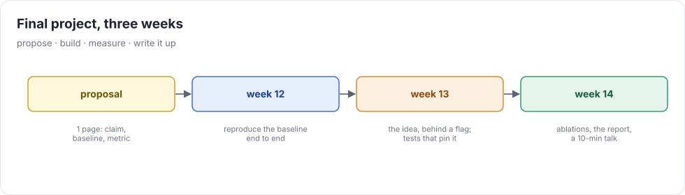

# Weeks 12–14 — Final project

Extend uc in a direction you care about. The bar is the same as the rest of the course: **a measurable claim,
a baseline, tests that pin the behavior, and a write-up a stranger could reproduce.**

## Choosing a project

Pick something that either (a) makes uc do something it couldn't, or (b) makes a number move, and say in advance
how you'll measure it. Three categories, with examples:

### Implement a paper

* **FlashAttention-3 on Hopper:** `wgmma`, TMA, warp specialization, and pingpong scheduling. Measure against your week-9 kernel and cuDNN/FA3.
* **Equality saturation** (egg) for the symbolic simplifier: does an e-graph prove more index identities, and what does it cost?
* **Ansor / auto-scheduling:** a learned or evolutionary search over week 7's actions. Measure search time vs. kernel quality.
* **FP8 training** (Hopper `e4m3`/`e5m2`) with per-tensor scaling, on GPT-2 124M. Measure loss vs. bf16 and speed.
* **Speculative decoding** with a small draft model. Measure the acceptance rate and end-to-end tokens/s.
* **Ring attention** across virtual devices for sequences that don't fit one device's memory.

### Port to unusual hardware

* An **AMD GPU** via HIP / hiprtc (rocWMMA or MFMA intrinsics for the tensor-core path).
* **Apple Silicon** via Metal (render MSL, drive it through `ctypes` + the Objective-C runtime), with `simdgroup_matrix`.
* **WebGPU** (WGSL) running in a browser, or a **RISC-V vector** CPU backend in QEMU.
* An **FPGA or accelerator simulator**: render to its ISA and validate with its simulator.

### Your own idea

* A static memory planner (buffer reuse by liveness) that cuts peak memory for GPT-2 training by X%.
* Quantized inference (int4 weights with AWQ/GPTQ-style scales) at Y tokens/s.
* A uc debugger: step through a kernel's UOps with values, in a TUI.
* Formal verification of a slice of the simplifier rules (Z3 or Lean): prove every rule sound.

## Deliverables

1. **Proposal** (end of week 11, 1 page): the claim, the baseline, the metric, the tests you'll add, the risks,
   and a fallback scope if the full idea doesn't work out.
2. **Code** (week 14): behind a flag, with tests. The full cumulative grader still passes.
3. **Report** (week 14, 4–6 pages, `docs/final/REPORT.md` or a PDF): motivation, design, what didn't work,
   results with error bars, ablations, and how to reproduce every number.
4. **Talk** (optional for self-study, highly recommended): 10 minutes, one demo.

## Rubric

| | weight |
|---|---|
| Technical depth and correctness (tests, soundness, the full suite still passes) | 35% |
| Results: a real measurement against a fair baseline, with an honest analysis | 30% |
| Simplicity: the change is as small as the idea allows; no regressions in code quality | 15% |
| Report: clear, reproducible, says what failed | 20% |
